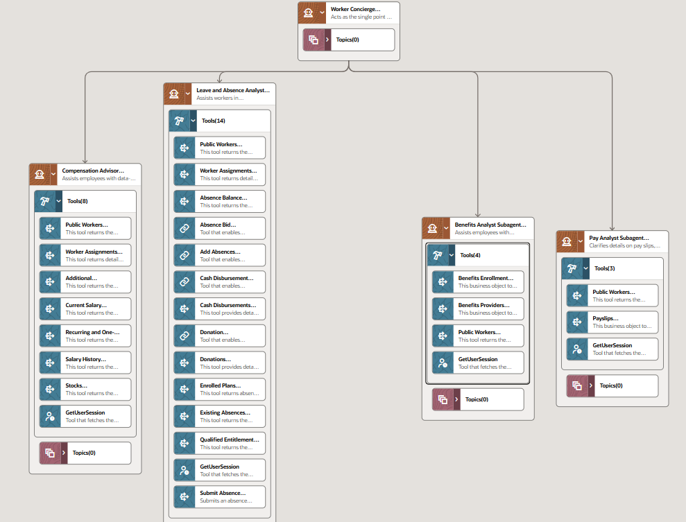
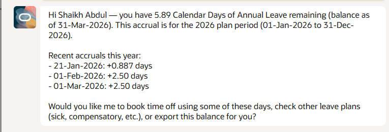
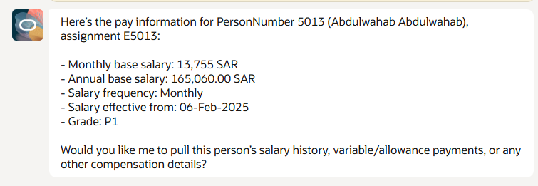
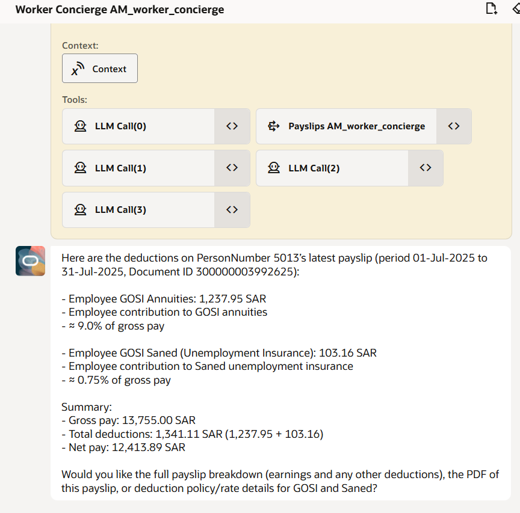
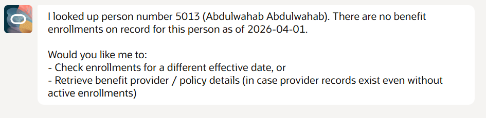

## How to Run: AM_Worker_Concierge Agent

## 🎯 Purpose

The **Worker_Concierge** is an AI-powered agent built on Oracle AI Agent Studio within Oracle Fusion Cloud HCM. It serves as a **single point of entry** for all employees seeking instant answers about their employment — including payroll, compensation, benefits, and leave — without needing to contact HR directly.

---

## 🤖 Agent Overview

| Field | Value |
|-------|-------|
| **Agent Team Name** | AM_Worker_Concierge |
| **Agent Team Code** | WORKER_CONCIERGE_AMWORKERCONCIERGE |
| **Type** | Supervisor (Multi-Agent) |
| **Family** | HCM |
| **Product** | Global Payroll / HCM |
| **Total Subagents** | 4 |
| **Total Tools** | 28 |
| **LLM** | Oracle Agent studio Default (GPT-5 mini) |

---

## � How to Access the Agent

### For Administrators (Testing)
1. Navigate to **Oracle Fusion Cloud HCM**
2. Go to **Navigator → Tools → AI Agent Studio**
3. Click **Agent Teams**
4. Search for **AM_Worker_Concierge**
5. Click the **▶ Play** button to open the test chat

### For End Users (After Publishing)
1. Navigate to **Oracle Fusion Cloud HCM**
2. Go to the **AI Agents** page
3. Find and open **AM_Worker_Concierge**
4. Start chatting!

---

## �👥 Total Number of Agents

### 1 Supervisor Agent
**Worker Concierge Supervisor**
Routes all employee queries to the correct specialist subagent automatically.

---

### 4 Subagents

#### 1. 🏖️ Leave and Absence Analyst — 13 Tools
Handles all leave and absence related queries.

**Capabilities:**
- View current leave balances
- Check absence history (past, present, future)
- View qualified entitlements (maternity, paternity, etc.)
- Check donation plans and disbursement plans
- View donation history and cash disbursement history
- *(Under Development)* Submit absence requests directly

**Tools Used:**
`GetUserSession`, `Public Workers`, `Worker Assignments`, `Absence Balance`, `Absence Bid`, `Add Absences (Deep Link)`, `Cash Disbursement`, `Cash Disbursements`, `Donation`, `Donations`, `Enrolled Plans`, `Existing Absences`, `Qualified Entitlements`

---

#### 2. 💰 Compensation Advisor — 8 Tools
Handles all salary and compensation related queries.

**Capabilities:**
- View current salary
- View salary history (past and future)
- Check stock options
- View bonuses and allowances
- Check one-time and recurring payments

**Tools Used:**
`GetUserSession`, `Public Workers`, `Worker Assignments`, `Additional Compensation`, `Current Salary`, `Recurring and One-Time Payments`, `Salary History`, `Stocks`

---

#### 3. 🏥 Benefits Analyst — 4 Tools
Handles all benefits enrollment and coverage queries.

**Capabilities:**
- View benefits enrollment details
- Check coverage information
- View benefits providers
- Check eligible programs and plans

**Tools Used:**
`GetUserSession`, `Benefits Enrollment Results`, `Benefits Providers`, `Public Workers`

---

#### 4. 💵 Pay Analyst — 3 Tools
Handles all payslip and payroll related queries.

**Capabilities:**
- View latest payslip
- Search payslips by date range
- View detailed earnings breakdown
- View deductions explanation

**Tools Used:**
`GetUserSession`, `Payslips`, `Public Workers`

---

##  General Queries — How to Use

### Payroll / Payslip Queries
| Query Example | What the Agent Does |
|---------------|---------------------|
| `What is my latest payslip?` | Fetches the most recent payslip with full breakdown |
| `Show my payslip for March 2026` | Fetches payslip for specified period |
| `Explain my deductions` | Provides breakdown of all deductions |
| `What is my net pay this month?` | Returns net pay amount for current period |

---

### Compensation Queries
| Query Example | What the Agent Does |
|---------------|---------------------|
| `What is my current salary?` | Returns current base salary |
| `Show my salary history` | Lists all past and future salary records |
| `Do I have any stock options?` | Returns stock information |
| `What bonuses have I received?` | Lists all bonus and award payments |

---

### Leave & Absence Queries
| Query Example | What the Agent Does |
|---------------|---------------------|
| `How many leave days do I have remaining?` | Returns current leave balance |
| `Show my absence history` | Lists all past and upcoming absences |
| `What leave types am I entitled to?` | Returns qualified entitlements |
| `Have I donated any leave?` | Shows donation history |

---

### Benefits Queries
| Query Example | What the Agent Does |
|---------------|---------------------|
| `What benefits am I enrolled in?` | Lists all active benefit enrollments |
| `Who is my benefits provider?` | Returns provider details |
| `What coverage do I have?` | Provides coverage details |

---

## 📸 Sample Agent Responses

### 🏖️ Leave and Absence Analyst
**Query:** *"How many leave I have remaining?"*

---

### 💰 Compensation Advisor
**Query:** *"Whats the salary of a person number 5013?"*

---

### 💵 Pay Analyst
**Query:** *"What is the latest payslip of person number 5013?"*

**Query:** *"Explain the deductions of person number 5013"*

---

### 🏥 Benefits Analyst
**Query:** *"What benefits person number 5013 is enrolled in?"*

---

## ⚙️ Technical Configuration

### Security Roles Configured
| Role | Purpose |
|------|---------|
| `AI_AGENT_ADMIN_ROLE` | Admin level access |
| `ABAM_AI_AGENT_EXPLORER_CUSTOM` | ABAM custom explorer role |
| `ORA_FND_APPLICATION_ADMINISTRATOR_JOB` | Application administrator |
| `AI_AGENT_EXPLORER` | General agent access |
| `COE_HCM_AI_AGENT_ADMIN` | HCM AI Agent admin |
| `XX_HCM_AI_AGENT_EXPLORER` | End user HCM agent access |

---

## 🔧 Known Limitations & Work In Progress

| Feature | Status | Notes |
|---------|--------|-------|
| View payslips | ✅ Working | Requires active payroll data |
| View salary | ✅ Working | Requires active payroll data |
| View leave balance | ✅ Working | Requires leave plan enrollment |
| View benefits | ✅ Working | Requires benefits enrollment |
| **Submit absence requests** | 🔄 In Progress | REST API integration under development |
| Upload HR policy documents | ⏳ Pending | Documents not yet uploaded |
| Publish for all users | ⏳ Pending | Awaiting full testing |

> **Note:** Testing has been conducted using a test instance. Full validation requires an employee account with active payroll and leave data configured in Oracle Fusion HCM.

