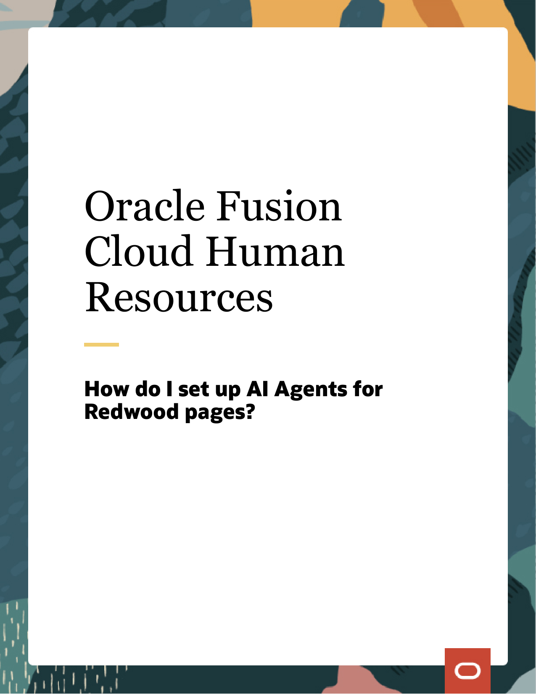
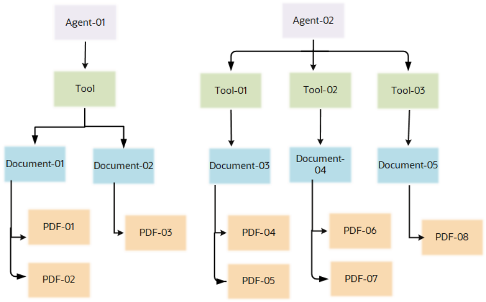
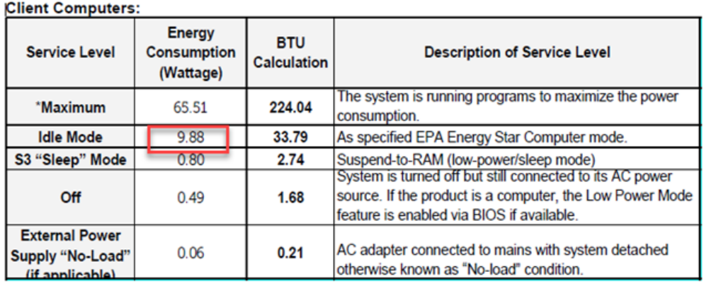

# Oracle Fusion Cloud Human Resources

### **How do I set up AI Agents for** **Redwood pages?**

Oracle Fusion Cloud Human Resources
How do I set up AI Agents for Redwood pages?

G22691-02

_[Copyright ©](https://docs.oracle.com/pls/topic/lookup?ctx=en%2Flegal&id=cpyr&source=)_ 2024, Oracle and/or its affiliates.

Author: Ashita Mathur

Oracle Fusion Cloud Human Resources
How do I set up AI Agents for Redwood pages?

### **Contents**

**Get Help** ................................................................................................................................ i

##### **1 [Introduction] 1**

Introduction ......................................................................................................................................................................................  1

##### **2 [Before You Start] 3**

[Access ................................................................................................................................................................................................ 3](#page-9)

Profile Options ................................................................................................................................................................................  3

##### **3 [Set Up AI Agents] 5**

[Configure Tool ................................................................................................................................................................................. 5](#page-11)

Configure Agent .............................................................................................................................................................................  5

[Run ESS Process ............................................................................................................................................................................. 5](#page-11)

[Configure Agent Guided Journey ............................................................................................................................................... 6](#page-12)

[Extend Application Page with Agent Guided Journey ........................................................................................................... 6](#page-12)

##### **4 [Author Documents to Maximize Answer Accuracy] 9**

[Document Content ......................................................................................................................................................................... 9](#page-15)

Document Structure ......................................................................................................................................................................  9

##### **5 [Evaluate Quality of Generated Answers] 11**

[Conduct Evaluations on the Quality of Answers Generated ................................................................................................ 11](#page-17)

[Create an Evaluation Data Set .................................................................................................................................................... 11](#page-17)

[Run Evaluations ............................................................................................................................................................................. 21](#page-27)

Oracle Fusion Cloud Human Resources
How do I set up AI Agents for Redwood pages?

Oracle Fusion Cloud Human Resources
How do I set up AI Agents for Redwood pages?

### Get Help

There are a number of ways to learn more about your product and interact with Oracle and other users.

###### Get Help in the Applications

Get Help

Some application pages have help icons to give you access to contextual help. If you don't see any help icons on
your page, click your user image or name in the global header and select Show Help Icons. If the page has contextual
help, help icons will appear.

###### Get Support

You can get support at _[My Oracle Support](https://support.oracle.com/portal/)_ . For accessible support, visit _[Oracle Accessibility Learning and Support](https://www.oracle.com/corporate/accessibility/learning-support.html#support-tab)_ .

###### Get Training

Increase your knowledge of Oracle Cloud by taking courses at _[Oracle University](https://www.oracle.com/education/)_ .

###### Join Our Community

Use _[Cloud Customer Connect](https://cloudcustomerconnect.oracle.com/pages/home)_ to get information from industry experts at Oracle and in the partner community. You
can join forums to connect with other customers, post questions, suggest _[ideas](https://community.oracle.com/customerconnect/categories/idealab-guidelines)_ for product enhancements, and watch
events.

###### Learn About Accessibility

For information about Oracle's commitment to accessibility, visit the _[Oracle Accessibility Program](https://www.oracle.com/corporate/accessibility/)_ . Videos included in
this guide are provided as a media alternative for text-based topics also available in this guide.

###### Share Your Feedback

We welcome your feedback about Oracle Applications user assistance. If you need clarification, find an error, or just
want to tell us what you found helpful, we'd like to hear from you.

You can email your feedback to _[oracle_fusion_applications_help_ww_grp@oracle.com](mailto:[oracle_fusion_applications_help_ww_grp@oracle.com](mailto:oracle_fusion_applications_help_ww_grp@oracle.com))_ .

Thanks for helping us improve our user assistance!

i

Oracle Fusion Cloud Human Resources
How do I set up AI Agents for Redwood pages?

Get Help

ii

Oracle Fusion Cloud Human Resources
How do I set up AI Agents for Redwood pages?

## **1 Introduction**

#### Introduction

You can deploy AI Agent-enabled Guided Journeys to effectively answer user questions about HR policies.

Chapter 1
Introduction

You can enable a conversational chat experience embedded within transactional pages by uploading information
sources such as policy documents, contracts, and government regulations. This enables users to ask questions and
receive precise, context-driven responses derived directly from the uploaded resources.

###### Structure of an Agent

An agent utilizes document tools to provide answers based on uploaded policies. You can assign multiple document
tools to an agent, each capable of containing one or more documents. A document represents a distinct source of
knowledge, and you can upload multiple files (attachments) to a document. These documents are presented as
discussion topics during a user chat experience.

The structure of an agent can be explained with the help of the following diagram

###### How You Can Use AI Agents

Agent enabled Guided Journeys provide the flexibility to configure the following:

    - Single Guided Journey Task with an agent having one or many discussion topics.

1

Oracle Fusion Cloud Human Resources
How do I set up AI Agents for Redwood pages?

Chapter 1
Introduction

    - Multiple Guided Journey Tasks where every task has a separate agent. Every agent in the task can have its own
discussion topics.

For example, you can set up agents as given below. A point to note is that you can set up Agents on any page that has
Guided Journeys enabled.

|Agent Name|Description|Navigation|
|---|---|---|
|Benefits Analyst|Helps employees understand and maximize their benefits packages, offering personalized insights on medical, dental, and vision coverage, based on individual needs.|Me > Benefits|
|Career Planning Guide|Guides employees in setting career goals and developing a roadmap to achieve them,  offering advice on skill development and career progression.|Me > Grow|
|Performance and Goals Assistant|Assists employees in setting and achieving performance goals, providing feedback and development plans to enhance job performance.|Me > Goals Center|
|Timecard Assistant|Facilitates accurate and timely submission of timecards, ensuring proper tracking of hours worked and compliance with labor laws. Provide explanation of how pay is calculated based on hours worked.|Me > Current Time Card|
|Leave and Absence Analyst|Helps employees navigate leave and absence policies, assisting with requests for time off and understanding their rights and benefits.|Me > Absence Balance|
|Employment Compensation Guide|The go-to resource for compensation related queries, offering clear insights into the organization's salary structure, benefits, bonuses, and incentives.|Me > Total Compensation Statement|
|Employment Details Assistant|Manages and updates employees' personal and employment information. Provide guidance on employee lifecycle events like promotions,  transfers, and relocations to ensure accuracy and compliance with company policies.|My Team > Team Activity Center|
|Employment Contracts Analyst|Provides guidance on employment contracts,  ensuring employees understand their terms and conditions.|My Team > Team Activity Center|
|New Hire Onboarding Assistant|An onboarding assistant that supports new employees through their initial days, offering information on company policies, culture, and essential resources.|Me > Journeys|
|Payslip Analyst|Clarifies details on payslips, helping employees understand their salary breakdown, deductions,  and compensation benefits.|Me > My Payslips|

2

Oracle Fusion Cloud Human Resources
How do I set up AI Agents for Redwood pages?

## **2 Before You Start**

#### Access

Before you set up an AI Agent, you need to grant privileges to your users.

Chapter 2
Before You Start

You need to grant this functional privilege to your user to access the Configure HCM Agents Admin page.

|Privilege|Description|
|---|---|
|HRC_MANAGE_AI_AGENT_PRIV|Enables management of intelligent agents, tools and documents.|

You need to grant this functional privilege to your users to access chats with agent enabled Guided Journeys,

|Privilege|Description|
|---|---|
|HRC_ACCESS_AI_AGENT_CHAT_PRIV|Allows access to intelligent agent chat component.|

#### Profile Options

You will require these profile options to work with AI Agents and Guided Journeys.

Verify that these profile options are set to **Y** at the site level:

|Profile Option Code|Profile Option Name|
|---|---|
|ORA_HCM_VBCS_PWA_ENABLED|Enable VBCS Progressive Web Application User Interface|
|ORA_PER_GUIDED_JOURNEYS_SETUP_ REDWOOD_ENABLED|Agent Task Type Enabled for Guided Journeys|
|ORA_PER_AGENT_TASK_TYPE_GUIDED_ JOURNEYS_ENABLED|Redwood Guided Journey Setup Page Enabled|

3

Oracle Fusion Cloud Human Resources
How do I set up AI Agents for Redwood pages?

Chapter 2
Before You Start

4

Oracle Fusion Cloud Human Resources
How do I set up AI Agents for Redwood pages?

## **3 Set Up AI Agents**

#### Configure Tool

You need to configure the AI Agent to add documents.

Chapter 3
Set Up AI Agents

**1.** Navigate to **My Client Groups > Tools > Configure HCM Agents** quick action.
**2.** Click **Add** . You will be prompted to create a new tool.
**3.** Enter the name and description.

**4.** Under **Documents**, add single or multiple documents to the tool. However, you can add one document at a time.
**5.** For each document, follow these steps:

     - Click **Add** to create a new document.

     - Enter the **Document Name** .

     - Click the attachment link to upload the corresponding attachment.

     - Save the document.

**6.** After saving all documents, click **Add** to add your **Tool** to the application.
**7.** On the Tools page, re-open the tool you created.
**8.** Notice the status of your documents is **Draft** . Edit each document and change the status to **Ready to Publish** .

#### Configure Agent

In this step, you will create an agent and bind it to the tool.

**1.** Navigate to the **Agents** tab.
**2.** Click **Add** to create a new agent.
**3.** Enter the **Name**, **Code**, **Description** and **Category** .
**4.** Under Tools, click **Add** and select the tool you created in the previous steps.
**5.** Click **Save** to bind the tool to the agent.
**6.** Click **Add** to add your agent to the application.

#### Run ESS Process

You need to run the Process Agent Documents ESS process to ingest the attachments.

**1.** Go to **Navigator > Scheduled Processes** .
**2.** Click **Schedule New Process** .
**3.** In the **Name** field, enter **Process Agent Documents** .

5

Oracle Fusion Cloud Human Resources
How do I set up AI Agents for Redwood pages?

**4.** Click **OK** and then **Submit** .
**5.** Return to the Configure HCM Agents page and re-open your tool.
**6.** Confirm that the status of your documents has changed to **Published** .

#### Configure Agent Guided Journey

You have to now configure the Agent Guided Journey.

**1.** Navigate to **My Client Groups** tab and click **Show More** .
**2.** Search for **Guided Journey** and open the page.
**3.** Click **Create** to create a new Guided Journey.

**4.** Enter a name for a guided journey and click **Create Draft** .

Chapter 3
Set Up AI Agents

|Under Tasks, click Add. Enter the following details -|Col2|
|---|---|
|Field|Value|
|Task Name|Enter a meaningful name as this will be displayed as a title on the Guided Journey banner.|
|Task Type|Agent|
|Configuration|Select the agent you created in the previous steps.|

**7.** Click **Save** .
**8.** Click **Activate** to activate your Guided Journey.

**What to do next**

Note the guided journey code, you will need it in further steps.

#### Extend Application Page with Agent Guided Journey

After you create the Guided Journey, you have to configure the application page with the guided journey task code

**1.** Go to the page you want to enhance with agent capabilities.
**2.** Go to Oracle Visual Builder Studio:

     - Click **Settings and Actions** in the top right.

     - Click **Edit Page in Visual Builder Studio** .

**3.** Create or select an existing project.
**4.** In the Business Rules panel, locate the page property for page level guided journey.
**5.** Enter the Guided Journey code noted previously.
**6.** Switch to the live view to test interactions with your agent.

6

Oracle Fusion Cloud Human Resources
How do I set up AI Agents for Redwood pages?

**7.** Follow your organization guide to publish your page customization.

Chapter 3
Set Up AI Agents

7

Oracle Fusion Cloud Human Resources
How do I set up AI Agents for Redwood pages?

Chapter 3
Set Up AI Agents

8

Oracle Fusion Cloud Human Resources
How do I set up AI Agents for Redwood pages?

Chapter 4
Author Documents to Maximize Answer Accuracy

## **4 Author Documents to Maximize Answer**
### **Accuracy**

#### Document Content

The content and structure of a document are key aspects to fetch the correct answer for your query.

    - Each document is a logical collection of attachments (files).

- Attachments must be in one of the following formats:

- PDF or Text.

**-** PDF files must meet accessibility standards.

    - English is the supported language.

    - Each attachment can consist of up to 300 pages.

    - Up to 500 files (attachments) can be added to a single document.

    - Total size of all attachments must not exceed 2 GB.

    - Multi-modal questions aren't supported:

      - Only questions about text-based content will be answered.

      - Questions about pictures, graphics, charts, and so on won't be answered.

    - Complex tables (running into several pages) aren't supported.

#### Document Structure

It’s highly recommended to structure your document using headings, subheadings, and so on.

Headings must clearly describe the meaning of the content in the subsequent section. Each section (under a heading)
must contain semantically related concepts. If you find that a section contains a mix of concepts, it’s advisable to create
new sections. Also, the various heading levels must be clearly distinguishable. For example, use font size 12 for Heading
1, font size 10 for Heading 2, font size 8 for Heading 3, and so on.

A well-constructed document structure enables the agent to split the document into semantically meaningful chunks.
This improves the quality of the generated answers.

Here's a comparison of two approaches to structuring a document:

|Approach 1|Approach 2|
|---|---|
|**Scope of Plan Coverage** This plan covers Employees of ACME.An "Employee" shall mean a common law Employee of ACME, Inc. (ACME), ACME International Corporation and ACME Software Technology GmbH. Independent contractors and/or "leased workers"|**Scope of Plan Coverage** This plan covers Employees of ACME and their dependents.   **Eligible Employees**   An "Employee" shall mean a common law Employee of ACME, Inc. (ACME), ACME International Corporation and ACME Software Technology GmbH. Independent contractors and/or "leased workers"|

9

Oracle Fusion Cloud Human Resources
How do I set up AI Agents for Redwood pages?

Chapter 4
Author Documents to Maximize Answer Accuracy

|Approach 1|Approach 2|
|---|---|
|engaged by a staff leasing company are not Employees for purposes of the Plan and therefore are not eligible to participate in the Plan.   Full and part time employees are covered as follows –   You may participate in one of the medical,  dental, vision, life/accidental death and dismemberment (AD&D), long term disability (LTD), and health care and dependent care flexible spending accounts (FSA) benefits offered under the Plan when you meet one of the eligibility requirements listed below.   • Regular Full-Time Employee on the ACME U.S. payroll scheduled to work 30 or more hours per week. • Regular Part-Time Employee on the ACME U.S. payroll scheduled to work 20-29 hours per week. • Interns and temporary Employees are not eligible to participate in the Plan as they are not regular Employees of ACME. INPATRIATES are covered as follows –   An Inpatriate (and eligible Dependents) residing in the United States for 90+ days and scheduled to work 30 -- 40 hours/ week for an ACME Entity will be enrolled, upon notifying, in the following benefits:   • ACME Premium PPO Medical • Dental Plan II • Vision Service Plan (VSP) Option 1 • An Inpatriate (and eligible Dependents) are not eligible for Life/Accidental Death and Dismemberment (AD&D) and Long- Term Disability (LTD) coverage. Your eligible dependents may be covered by the medical, dental, vision, and life insurance options under the Plan when Your Dependent meets one of the eligibility requirements listed in this section. NOTE: Your Dependents may not enroll in a particular benefit option offered under the Plan unless You are also enrolled |engaged by a staff leasing company are not Employees for purposes of the Plan and therefore are not eligible to participate in the Plan.   **FULL & PART TIME EMPLOYEES**     You may participate in one of the medical, dental, vision, life/accidental death and dismemberment (AD&D), long term disability (LTD), and health care and dependent care flexible spending accounts (FSA) benefits offered under the Plan when you meet one of the eligibility requirements listed below.   • Regular Full-Time Employee on the ACME U.S. payroll scheduled to work 30 or more hours per week. • Regular Part-Time Employee on the ACME U.S. payroll scheduled to work 20-29 hours per week. • Interns and temporary Employees are not eligible to participate in the Plan as they are not regular Employees of ACME. **INPATRIATES**     An Inpatriate (and eligible Dependents) residing in the United States for 90+ days and scheduled to work 30 -- 40 hours/week for an ACME Entity will be enrolled, upon notifying, in the following benefits:   • ACME Premium PPO Medical • Dental Plan II • Vision Service Plan (VSP) Option 1 • An Inpatriate (and eligible Dependents) are not eligible for Life/Accidental Death and Dismemberment (AD&D) and Long-Term Disability (LTD) coverage. **ELIGIBLE DEPENDENTS**     Your eligible Dependents may be covered by the medical, dental, vision, and life insurance options under the Plan when Your Dependent meets one of the eligibility requirements listed in this section. NOTE: Your Dependents may not enroll in a particular benefit option offered under the Plan unless You are also enrolled.   |

Approach 2 is highly recommended. Breaking the document into semantically related content, organized by the various coverage categories,
enables the agent to provide more relevant answers to questions about benefits coverage. Also, note that the various heading levels are visually
distinguishable.

10

Oracle Fusion Cloud Human Resources
How do I set up AI Agents for Redwood pages?

Chapter 5
Evaluate Quality of Generated Answers

## **5 Evaluate Quality of Generated Answers**

#### Conduct Evaluations on the Quality of Answers Generated

You need to conduct evaluations to ensure the Oracle Fusion AI Agent is working effectively and accurately.

To conduct evaluations, you need to:

    - Create an evaluation data set.

      - This set consists of carefully crafted questions along with expected answers.

    - Feed the questions to the Agent.

    - Compare the answers generated by the agent with the expected answers.

    - Evaluate answers for correctness.

#### Create an Evaluation Data Set

Here’s an example of an evaluation data set:

|Number|Query|Expected Answer|
|---|---|---|
|ACME_UTD_SPD_001|Is aromatherapy covered|No, aromatherapy is not covered. According to the provided context, aromatherapy is listed under "Alternative Treatments" which are not covered by UnitedHealthcare Medical Plans.|
|ACME_UTD_SPD_002|do you pay for thermometers|Based on the provided context, thermometers are not covered under the UnitedHealthcare Medical Plans. Specifically, the document titled "MEDICAL SUPPLIES AND APPLIANCES" lists thermometers as excluded supplies.|
|ACME_UTD_SPD_003|Is laser surgery for eyes covered by United|Based on the provided context, laser surgery for eyes is not covered by UnitedHealthcare Medical Plans. The relevant document text under the "VISION" section states that surgery and other related treatments intended to correct nearsightedness, farsightedness,  presbyopia, and astigmatism, including procedures such as radial keratotomy and laser surgery, are listed under plan exclusions. Therefore, these procedures are not covered by UnitedHealthcare Medical Plans.|

11

Oracle Fusion Cloud Human Resources
How do I set up AI Agents for Redwood pages?

Chapter 5
Evaluate Quality of Generated Answers

Questions must be designed to test the agent’s ability to deal with various complexities in analyzing the source
documents. Use the following guidelines to develop these questions:

    - **Long Range Context**     - Some questions require information that’s scattered across distant sections of the
document. Check if the Agent can successfully resolve such long-range dependencies that may extend across
several pages.

    - **Distributed Context**     - Ensure the Oracle Fusion AI Agent can gather information from multiple non-contiguous
parts of the document to answer a question comprehensively. This tests the system’s ability to aggregate and
synthesize information from diverse sections.

    - **Concealed Context**     - Test whether the Oracle Fusion AI Agent can find and extract specific, obscure, or hardto-spot details from deep within the text.

    - **Reasoning**     - Check if the AI Agent can not only retrieve information but also apply reasoning to provide a
correct answer.

    - **Table-Sourced**     - Test the AI agent’s ability to interpret and pull accurate data from tables within the document.

##### Long Range Context

Think of questions that require the AI Agent to piece together details found in distant parts of the document.

For instance, Benefits policy documents often contain sections for 'covered' and 'excluded' benefits. Imagine the user
asks this question:

**Question**

“Are supplements and electrolytes covered?”

**Answer**

“No, high protein nutrition supplements are not covered. According to the context provided, nutritional or cosmetic therapy using high dose or
mega quantities of vitamins, minerals, or elements, and other nutrition-based therapy, including high protein foods, are excluded from coverage.
This exclusion applies to supplements, electrolytes, and foods of any kind, including high protein foods and low carbohydrate foods.”

Excerpts from the Source Document:

Page 80 introduces the plan exclusions section:

**Plan Exclusions – What Is Not Covered**

The Plan Exclusions are categorized and listed within key categories. These Exclusions apply to all Covered Persons. The Plan will **not pay or**
**approve benefits** for any of the services, treatments, supplies, or other items described in this section, even if one or both of the following is true:

   - It is recommended or prescribed by a Provider (Network and Non-Network); and

   - It is the only available treatment for Your condition

   - ….

Page 81 starts the list of exclusions:

**Alternative Treatments**

12

Oracle Fusion Cloud Human Resources
How do I set up AI Agents for Redwood pages?

Chapter 5
Evaluate Quality of Generated Answers

   - Acupuncture treatment or therapy designed to provide the Covered Person continued well-being, or maintain the optimum state of health,
while minimizing recurrence of the clinical status. Acupuncture treatment to address chronic pain, disease, or injury is a Covered Health
Services. For more information, refer to Acupuncture in Covered Health Services.

   - Acupressure

   - Aromatherapy

   - …

Page 86 lists nutrition exclusions:

**Nutrition**

   - Nutritional or cosmetic therapy using high dose or mega quantities of vitamins, minerals or elements, and other nutrition-based therapy.
**Examples include supplements**, electrolytes and foods of any kind (including high protein foods and low carbohydrate foods).

To generate the expected answer, the Oracle Fusion AI Agent needs to correlate information present on page 81
(where the list of exclusions starts) with the information on page 86 (which covers supplements). If the Agent skips the
information on page 81, it may erroneously conclude that supplements are covered.

##### Distributed Context

Create questions where the answer involves synthesizing data from several non-adjacent sections.

**Question**

“What coverage do you offer for chemotherapy?”

**Answer**

“1. **Intravenous Chemotherapy**:

 - Chemotherapy received on an outpatient basis at a hospital or alternate facility is covered. This includes the facility charge, and the charge for
required services, supplies, and equipment. Benefits for facility-based physician's fees related to these services are described under Physician Fees
for Surgical and Medical Services.

2. **Outpatient Therapeutic Services**:

 - Intravenous chemotherapy or other intravenous infusion therapy is covered under outpatient therapeutic services. Prior authorization is required
for these services.

3. **Outpatient Surgery, Diagnostic, and Therapeutic Services**:

 - Cancer chemotherapy and intravenous infusion therapy are included under other diagnostic tests and therapeutic treatments received on an
outpatient basis at a hospital or alternate facility.

4. **Wigs**:

 - Coverage is available for wigs prescribed by a physician when hair loss is the result of chemotherapy and radiation treatment for cancer. The
benefit for wigs is limited to a maximum of $500 of billed charges per diagnosis.

13

Oracle Fusion Cloud Human Resources
How do I set up AI Agents for Redwood pages?

5. **Acupuncture**:

 - Acupuncture is covered when used for the treatment of nausea resulting from chemotherapy.

Excerpts from the Source Document:

Under the **Covered Health Services** heading:

Page 61 explains outpatient chemotherapy is covered.

Chapter 5
Evaluate Quality of Generated Answers

**OUTPATIENT THERAPEUTIC**

IMPORTANT: Prior Authorization is required.

The Plan pays for Covered Health Services for therapeutic treatments received on an outpatient basis at a Hospital or Alternate Facility, including
dialysis (both hemodialysis and peritoneal dialysis), **intravenous chemotherapy** or other intravenous infusion therapy, and other treatments not
listed above.

Benefits under this section include the facility charge, and the charge for required services, supplies and equipment. Benefits for facility-based
Physician's fees related to these services are described under Physician Fees for Surgical and Medical Services.

When these services are performed in a Physician's office, benefits are described under Physician's Office Services.

Page 80 includes information about coverage for wigs when hair loss is the result of chemotherapy:

**Wigs**

Coverage is available for wigs prescribed by a Physician when the **hair loss is the result of a medical condition (such as chemotherapy and**
**radiation treatment for cancer)** . The benefit for wigs is limited to a maximum of $500 of billed charges per diagnosis, regardless of the network
status of the Provider. Please note that Network Deductibles and Coinsurance apply to a Non-Network Provider when a Network Provider is not
available.

Page 38 includes information about acupuncture for the treatment of nausea resulting from chemotherapy:

**Acupuncture**

Acupuncture is a Covered Health Service when services are provided by an Acupuncturist who is practicing within the scope of his or her license or
certification and the laws of jurisdiction when used for the treatment of:

   - Chronic Pain

   - Disease and injury

   - **Nausea resulting from Chemotherapy, Post Operation, or Pregnancy**

Maintenance Acupuncture is not a Covered Health Service. See Exclusions.

Page 47 explains that cover for fertility preservation is available for medical reasons that cause irreversible infertility
such as chemotherapy:

14

Oracle Fusion Cloud Human Resources
How do I set up AI Agents for Redwood pages?

Chapter 5
Evaluate Quality of Generated Answers

**FERTILITY PRESERVATION FOR IATROGENIC INFERTILITY**

Benefits are available for fertility preservation for medical reasons that cause irreversible infertility such as chemotherapy, radiation treatment, and
bilateral oophorectomy due to cancer. Services include the following procedures, when provided by or under the care or supervision of a Physician:

   - Collection of sperm.

   - Cryo-preservation of sperm.

   - Ovarian stimulation, retrieval of eggs and fertilization.

   - Oocyte cryo-preservation.

   - Embryo cryo-preservation.

   - Storage up to one year.

Benefits are not available for long-term storage costs (greater than one year).

The information to answer this question completely is spread across several different sections in the policy document.
The Oracle Fusion AI Agent must first retrieve all the relevant information before synthesizing the content into a
comprehensive, cogent answer.

##### Concealed Context

Formulate questions that ask for less obvious details. These are often questions about rare exceptions, unusual
conditions, or lesser-known facts embedded within the policy. The answer exists but may be hard to find due to its
placement in the document.

**Question**

“How can I order refills for my arthritis medication?”

**Answer**

“Arthritis is classified as a Specialty Medication

If a medication is identified as a Specialty Medication -- it must be filled through mail order by a designated OptumRx Specialty Pharmacy, Optum
Specialty Pharmacy or another designated Specialty Pharmacy in the OptumRx Specialty Network. Specialty Medications not filled by a designated
OptumRx Specialty Pharmacy, including Network OptumRx Retail Pharmacies, will NOT be covered by the Plan. If Specialty Medications are filled by
a non-designated OptumRx Specialty Pharmacy, benefits are NOT paid and You are responsible for 100% of the actual medication cost.

For more information, contact the Specialty Pharmacy Referral Line at 1-888-702-8423 (available 24 hours a day, 7 days a week).

Excerpts from the Source Document:

Under the **Covered Health Services** heading:

Page 65 includes the prescription coverage.

**Prescriptions – Plan Coverage**

15

Oracle Fusion Cloud Human Resources
How do I set up AI Agents for Redwood pages?

Chapter 5
Evaluate Quality of Generated Answers

Each Prescription Drug Tier is assigned a cost (Copayment or Coinsurance) which is the amount You pay at a retail pharmacy, or the amount You
pay if You have Maintenance Medications filled through the Plan’s mail order program. Your Out-of-Pocket Prescription costs apply to the Plan’s
Deductible and Out-of-Pocket Maximum accumulators. The information following is a Plan coverage overview applicable to all UnitedHealthcare
Medical Plans. Exceptions apply to the HSA Medical Plan. Refer to "Prescriptions - HSA Medical Plan" to review Plan coverage. For more information
about Prescription coverage details for all Plans, refer to Medical Plan Comparison Chart.

**Prescriptions – Summary of Coverage**

   - **Tier - 1**   - Covered at 100% after Copayment

   - **Tier - 2**   - Covered at 100% after Coinsurance o Plan Deductible – Not Applicable o Assigned Out-of-Pocket Prescription cost “minimum” and
“maximum” apply o Your cost will be no less than the assigned minimum o Your cost will not exceed the assigned maximum

   - **Tier - 3**   - Covered at 100% after Coinsurance o Plan Deductible – Not Applicable o Assigned Out-of-Pocket Prescription cost “minimum” and
“maximum” apply o Your cost will be no less than the assigned minimum o Your cost will not exceed the assigned maximum

   - **Specialty Medications**   - Special fill requirements apply to Specialty Medications o Must be filled at a Specialty Pharmacy, Optum Specialty
Pharmacy or other OptumRx designated Specialty pharmacy providers o 31 Day Supply Only

Page 68 lists example of specialty medication.

**Specialty Medication - Examples**

Specialty Medications are used to treat rare, unusual, or complex medical conditions including, but are not limited to the medications included in the
table below. Self- administered diabetes products are not classified as a Specialty Medication.

|Allergic Asthma|Immune Deficiency|
|---|---|
|Anaemia|Fertility|
|**Arthritis**|Multiple Sclerosis|
|Cancer|Cystic Fibrosis|
|Endocrine Disorder|Osteoporosis|
|Enzyme Deficiency|Parkinson’s Disease|
|Excess Iron|Psoriasis|
|Growth Hormone Deficiency|Pulmonary Arterial Hypertension|
|Haemophilia|Respiratory Syncytial Virus|
|Hepatitis B|Thrombocytopenia|
|Hepatitis C|Transplant|
|HIV/AIDS|Vaccines|

To answer this question correctly, it is crucial to identify that arthritis falls in the category of specialty medication. The
procedure for specialty medication refill is different from normal medication. This information is obscured inside a large
table. An AI agent may have difficulty extracting this information. If this information is not retrieved, the AI agent may
incorrectly provide advice on how to refill regular medication.

16

Oracle Fusion Cloud Human Resources
How do I set up AI Agents for Redwood pages?

Chapter 5
Evaluate Quality of Generated Answers

##### Reasoning - Logical, Mathematical, or Temporal

Develop questions that require the AI agent to apply logic, simple math, or understand time-based rules. Examples
could include:

Question

“If I contribute $8,000 towards my 401(k) and I have 100% company match contribution, what is my total saved in that year?

**Answer**

“To determine your total savings in the year with a 100% company match contribution, we need to consider both your contributions and the
company's matching contributions.

   - _1._ _**Your Contribution**: $8,000_

   - _2._ _**Company Match Contribution**: 100% of your contribution, which is also $8,000_

_Therefore, your total saved in the year would be: $8,000 + $8,000 = $16,000”_

This question requires simple mathematical calculation, along with an understanding of what "company match" means.

**Question**

“If an employee worked part-time for six months and switched to full-time after, how many vacation days would they accrue by the end of the year?”

**Answer**

_“The employee would accrue 10 days of vacation by the end of the year.”_

This question requires the system to integrate accrual rates for both part-time and full-time statuses, account for time
spent in each, and apply the vacation policy correctly.

**Question**

“I joined on March 1st 2024; my eligible pay is 100,000. I want to contribute 10% to my 401K. What is the maximum amount I will be eligible in May
2026 Please include company matching. Think carefully step by step”

This answer requires a combination of logical, mathematical, and temporal thinking.

**Answer**

“To determine the maximum amount, you will be eligible for in your 401(k) by May 2026, including company matching, we need to consider several
factors:

1. **Your Contributions**: - You plan to contribute 10% of your eligible pay. - Your eligible pay is $100,000 annually. - Therefore, your annual
contribution will be 10% of $100,000, which is $10,000.

17

Oracle Fusion Cloud Human Resources
How do I set up AI Agents for Redwood pages?

Chapter 5
Evaluate Quality of Generated Answers

2. **Company Matching**: - The company offers a discretionary matching contribution up to 7% of eligible pay. - You are eligible for the matching
contribution after completing 1,000 hours of service as of your one-year anniversary or as of the end of the next plan year. - Since you joined on
March 1, 2024, you will be eligible for matching contributions starting from March 1, 2025.

3. **Vesting Schedule**: - The vesting schedule is as follows: - 0-2 years: 0% - 2 years: 50% - 3 or more years: 100% - By May 2026, you will have
completed more than 2 years but less than 3 years of service, so you will be 50% vested in the company’s contributions.

4. **Calculations**: - **Your Contributions**: - From March 1, 2024, to March 1, 2025: $10,000 - From March 1, 2025, to March 1, 2026: $10,000 From March 1, 2026, to May 2026 (2 months): $10,000 / 12 * 2 = $1,666.67 - Total your contributions by May 2026: $10,000 + $10,000 + $1,666.67 =
$21,666.67

 - **Company Matching Contributions**: - From March 1, 2025, to March 1, 2026: 7% of $100,000 = $7,000 - From March 1, 2026, to May 2026 (2
months): $7,000 / 12 * 2 = $1,166.67 - Total company matching contributions by May 2026: $7,000 + $1,166.67 = $8,166.67

 - **Vested Company Contributions**: - By May 2026, you will be 50% vested in the company’s contributions. - Vested amount: 50% of $8,166.67 =
$4,083.34

5. **Total Eligible Amount**: - Your contributions: $21,666.67 - Vested company contributions: $4,083.34 - Total eligible amount in your 401(k) by
May 2026: $21,666.67 + $4,083.34 = $25,750.01

Therefore, by May 2026, the maximum amount you will be eligible for in your 401(k), including company matching, is $25,750.01.”

##### Table-Sourced Questions

If your policy contains tables, create questions specifically aimed at retrieving data from these tables.

**Question**

“How much energy does the Inspiron consume when idle?”

This question targets content in a single cell in the table

**Source Table**

18

Oracle Fusion Cloud Human Resources
How do I set up AI Agents for Redwood pages?

**Answer**

Chapter 5
Evaluate Quality of Generated Answers

“When the Dell Inspiron 14 (3420) is in Idle Mode, it consumes 9.88 Watts of energy.

Specifically, the “Client Computers” section provides a table with energy consumption data for different service levels. For the “Idle Mode” row, it
states:

Idle Mode | 9.88 | 33.79 | As specified EPA Energy Star Computer mode.

The 9.88 figure represents the energy consumption in Watts when the computer is in idle mode. The document also notes that this idle mode is as
specified by the EPA Energy Star Computer mode. Additionally, the table provides the BTU (British Thermal Unit) calculation for this idle state, which
is 33.79 BTU. The document explains that BTU is calculated based on the wattage reading, assuming the service level is attained for one hour, using
the conversion 1 Watt = 3.42 BTU.

It’s worth noting that these measurements were taken at 230 Volts / 50 Hz, which is important for understanding the test conditions.”

**Example Question**

“Can you compare mail order drug delivery across all the plans?”

This question requires synthesizing content across cells in the table.

_**Source Table**_

|Plan Feature|EPO NETWORK PLAN|HSA PLAN|PPO PLAN|
|---|---|---|---|
|**Availability**|Nationwide|Nationwide except KY|Nationwide except AZ|
|**Annual Deductible**   • Employee • Family|Embedded   $1,700   $5,000 |Aggregate   $2,200   $4,4001 |Embedded   $1,000   $2,000 |

Embedded

Embedded

**Annual Out-of-Pocket Max** Embedded

19

Oracle Fusion Cloud Human Resources
How do I set up AI Agents for Redwood pages?

Chapter 5
Evaluate Quality of Generated Answers

|• Employee • Family|$4,500 $14,000|$5,000 $11,000|$4,000 $7,500|
|---|---|---|---|
||**NETWORK ONLY YOU PAY**|**IN-NETWORK YOU PAY**|**IN-NETWORK YOU PAY**|
|**Preventive Care**|$03|$03|$03|
|**Telemedicine Visit** • Medical • Mental Health • Dermatology • Nutrition|$25 per visit   $25 per visit   $25 per visit   $25 per visit |$25 per visit   $25 per visit   $25 per visit   $25 per visit |$25 per visit   $25 per visit   $25 per visit   $25 per visit |
|**Office Visit** • Primary Care • Specialist|$20 copay3   $40 copay3 |20%2   20%2 |20%2   20%2 |
|**Urgent Care**|$40 copay3|20%2|20%2|
|**Emergency Room**|$200 copay + 30%2|20%2|$200 copay + 20%2|
|**Diagnostic Testing**|PCP office: $20 copay3 Specialist office: $40 copay3|20%2|20%2|
|**Outpatient X-Ray and Lab**|PCP office: $20 copay3 Specialist office: $40 copay3|20%2|20%2|
|**Hospitalization** • Inpatient Semi-Private Room • Inpatient Physician|30%2   30%2 |20%2   20%2 |20%2   20%2 |
|**Outpatient Treatment**   (Physical, Occupational & Speech) |$50 copay3|20%2|20%2|
|**Mental Health/Substance Abuse** • Inpatient • Outpatient|30%2   $25 copay3   (Outpatient Psychotherapy) |20%2   20%2 |20%2   20%2 |
|**Pharmacy Retail**|**30-day supply**|**30-day supply**|**30-day supply**|
|• Annual Deductible Applies ◦ Pharmacy Out-of-Pocket Max ◦ Specified Preventive Drugs3,4 ◦ Generic ◦ rand Preferred ◦ Brand Non-Preferred|No   Combined with medical   N/A   $10 copay   20% (min $30, max $100)   30% (min $60, max $120) |Yes   Combined with medical   100% covered3,4,5   $10 copay   20%2 (min $30, max $100)   30%2 (min $60, max $120) |No   Combined with medical   N/A   $10 copay   20% (min $30, max $100)   30% (min $60, max $120) |

20

Oracle Fusion Cloud Human Resources
How do I set up AI Agents for Redwood pages?

Chapter 5
Evaluate Quality of Generated Answers

|• Pharmacy Retail/Mail Order|90-day supply|90-day supply|90-day supply|
|---|---|---|---|
|• Specified Preventive Drugs3,4 • Generic • Brand Preferred ◦ Brand Non-Preferred|N/A   $30 copay   20% (min $90, max $270)   30% (min $180, max $360) |100% covered3,4,5   $30 copay   20%2 (min $90, max $270)   30%2 (min $180, max $360) |N/A   $30 copay   20% (min $90, max $270)   30% (min $180, max $360) |

**Answer**

“Based on the provided context, here is a comparison of mail order drug delivery across the EPO Network Plan, HSA Plan, and PPO Plan:

### EPO Network Plan - **90-day supply**: - **Specified Preventive Drugs**: Not applicable (N/A) - **Generic**: $30 copay - **Brand
Preferred**: 20% (minimum $90, maximum $270) - **Brand Non-Preferred**: 30% (minimum $180, maximum $360)

### HSA Plan - **90-day supply**: - **Specified Preventive Drugs**: 100% covered - **Generic**: $30 copay - **Brand Preferred**: 20%
(minimum $90, maximum $270) - **Brand Non-Preferred**: 30% (minimum $180, maximum $360)

### PPO Plan - **90-day supply**: - **Specified Preventive Drugs**: Not applicable (N/A) - **Generic**: $30 copay - **Brand Preferred**: 20%
(minimum $90, maximum $270) - **Brand Non-Preferred**: 30% (minimum $180, maximum $360) ... - **Brand Non-Preferred Drugs**: All plans
require 30% coinsurance with a minimum of $180 and a maximum of $360.

In conclusion, the HSA Plan offers the most comprehensive coverage for specified preventive drugs at 100%, while the EPO Network Plan and
PPO Plan do not cover specified preventive drugs under mail order. For generic, brand preferred, and brand non-preferred drugs, the copays and
coinsurance percentages are consistent across all three plans”

#### Run Evaluations

You need to evaluate each answer and give it a scoring.

    - Record the answer generated by the AI Agent for each question in the data set, .

    - Assign a correctness score for each generated answer, along with an explanation of why the score was
assigned.

###### Scoring Guidelines

Follow these guidelines for scoring:

    - Your score must be between 1 and 5, where 1 is the lowest and 5 is the highest score.

    - If the generated answer is completely incorrect or not relevant to the user query, give a score of 1.

    - If the generated answer is relevant but contains mistakes, or is partially correct, give a score between 2 and 3.

    - If the generated answer is relevant and fully correct, give a score between 4 and 5.

21

Oracle Fusion Cloud Human Resources
How do I set up AI Agents for Redwood pages?

###### Evaluation Example

Here's an example of an evaluation:

Chapter 5
Evaluate Quality of Generated Answers

|Number|Query|Expected Answer|AI Agent Answer|Correctness Score|Comments|
|---|---|---|---|---|---|
|ACME_UPD_SPD_ 001|Is aromatherapy covered|No, aromatherapy is not covered. According to the provided context,  aromatherapy is listed under 'Alternative Treatments' which are not covered by UnitedHealthcare Medical Plans.|No, aromatherapy is not covered. According to the given context,  aromatherapy is listed under the 'Alternative Treatments' section of the plan exclusions,  which means it is not covered by the plan.|5|The generated answer is relevant and fully correct,  closely matching the reference answer in both content and structure, effectively conveying that aromatherapy is not covered under the plan due to its classification as an 'Alternative Treatment.'|
|ACME_UPD_SPD_ 002|Do you pay for thermometers|Based on the provided context, thermometers are not covered under the UnitedHealthcare Medical Plans. Specifically, the document titled 'MEDICAL SUPPLIES AND APPLIANCES' lists thermometers as excluded supplies.|There is no mention of thermometers in the provided context. Therefore, the answer is no, thermometers are not paid for.|4|The generated answer is relevant and correct,  aligning with the reference answer's conclusion that thermometers are not covered. However,  it lacks the specific detail provided in the reference answer about the source of this information, which could be useful for understanding the context and reliability of the statement.|

22