<a id="page-1"></a>

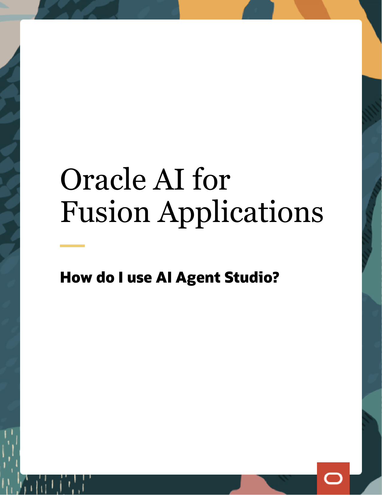
# Oracle AI for Fusion Applications

### **How do I use AI [Agent Studio](#page-13)?**

<a id="page-2"></a>

Oracle AI for Fusion Applications
How do I use AI Agent Studio?

G36251-17

_[Copyright ©](https://docs.oracle.com/pls/topic/lookup?ctx=en%2Flegal&id=cpyr&source=)_ 2025, 2026, Oracle and/or its affiliates.

Author: Soniya Mathew

<a id="page-3"></a>

Oracle AI for Fusion Applications
How do I use AI Agent Studio?

### **Contents**

**Get Help** ................................................................................................................................ i

##### **1 [Overview] 1**

[Overview of AI Agent Studio ........................................................................................................................................................ 1](#page-9)

[Key Capabilities of AI Agent Studio ............................................................................................................................................ 1](#page-9)

Components of AI Agent Studio .................................................................................................................................................  1

##### **2 [Access Requirements for AI Agent Studio] 5**

[Access Requirements for AI Agent Studio](#page-13) ...............................................................................................................................  5

[Provide Access to Configure AI Agents in all Products ......................................................................................................... 7](#page-15)

[Provide Access to Configure AI Agents in Oracle Fusion Cloud Human Capital Management ..................................... 8](#page-16)

[Provide Access to Configure AI Agents in Oracle Fusion Cloud Supply Chain & Manufacturing ................................ 12](#page-20)

[Provide Access to Configure AI Agents in Oracle Fusion Cloud Procurement ................................................................ 17](#page-25)

[Provide Access to Configure AI Agents in Oracle Fusion Cloud Financials ..................................................................... 22](#page-30)

[Provide Access to Configure AI Agents in Oracle Fusion Cloud CX .................................................................................. 23](#page-31)

[Provide Access to Configure AI Agents in Oracle Permitting and Licensing](#page-31) ..................................................................  23

##### **3 [Before You Begin] 29**

[Choose How to Create AI Agents ............................................................................................................................................. 29](#page-37)

Get Started with AI Agent Studio ............................................................................................................................................  30

[Add External REST Tool .............................................................................................................................................................. 32](#page-40)

Add MCP Tool ...............................................................................................................................................................................  33

Add Your [LLM](https://support.oracle.com/support/?documentId=KB863374) ...............................................................................................................................................................................  33

##### **4 [Use Cases] 35**

[Use Cases for Agents of Type Supervisor .............................................................................................................................. 35](#page-43)

##### **5 [Create AI Agents] 43**

Create AI Agents Using Preconfigured Templates ...............................................................................................................  43

[Create Custom AI Agents of Type Supervisor ....................................................................................................................... 46](#page-54)

<a id="page-4"></a>

Oracle AI for Fusion Applications
How do I use AI Agent Studio?

[Create Custom AI Agents of Type Workflow ......................................................................................................................... 48](#page-56)

##### **6 [Monitor and [Evaluate AI Agents](#page-71)] 63**

[Monitor and](#page-71) Evaluate AI Agents ..............................................................................................................................................  63

[Monitor Agents ............................................................................................................................................................................. 65](#page-73)

[Evaluate Agents ............................................................................................................................................................................ 65](#page-73)

[Compare Evaluation Runs .......................................................................................................................................................... 67](#page-75)

##### **7 [Migrate RAG Agents to AI Agent Studio] 69**

[Migrate Document Tools of RAG Agents](#page-77) ...............................................................................................................................  69

##### **8 [Promote Published Agents] 71**

Migrate AI Agents from One Instance to Another ................................................................................................................  71

##### **9 [Create Channels in AI Agent Studio] 73**

[Create Microsoft Teams Channel for AI Agent Studio ......................................................................................................... 73](#page-81)

[Create Slack Channel for AI Agent Studio .............................................................................................................................. 75](#page-83)

##### **10 [Allow External Access to Fusion Applications Agents] 77**

Enable Applications to Access Fusion Applications Agents ...............................................................................................  77

##### **11 [AI Agent Studio FAQs] 81**

When do I need a Custom AI Agent Subscription for AI Agent Studio? ..........................................................................  81

Which large language models (LLMs) are currently used or supported for AI agents? ................................................  81

[Can I use any agent in my agent team or workflow? ........................................................................................................... 81](#page-89)

[When should I use a single-agent flow vs a multiagent process? ..................................................................................... 81](#page-89)

[Can I edit a preconfigured agent team? ................................................................................................................................. 82](#page-90)

[How do I make agents respond faster? .................................................................................................................................. 82](#page-90)

[How do I track the usage of AI Agents created in AI Agent Studio? ................................................................................ 83](#page-91)

How can I best reduce the risk of my agent showing hallucinations? .............................................................................  83

[How do I hide or restrict access to AI Agent Studio for specific users? ........................................................................... 83](#page-91)

Can I rename the AI chat label to something other than Ask Oracle, or change the design of the chat panel? .....  83

[What's the difference between editing a topic versus editing a system prompt? ......................................................... 84](#page-92)

What types of files can I upload as part of document tools in AI Agent Studio? ..........................................................  84

<a id="page-5"></a>

Oracle AI for Fusion Applications
How do I use AI Agent Studio?

[Why does the external REST tool only support HTTPS transactions? ............................................................................. 84](#page-92)

Why is the Provider list in the LLM tab empty? ...................................................................................................................  84

Why can't I see all agent teams in the Agent Teams tab of AI Agent Studio? ..............................................................  84

[Why is my agent not fetching data from the document added to it? .............................................................................. 85](#page-93)

Why is the Roles list in the Security tab empty? ..................................................................................................................  85

<a id="page-6"></a>

Oracle AI for Fusion Applications
How do I use AI Agent Studio?

<a id="page-7"></a>

Oracle AI for Fusion Applications
How do I use AI Agent Studio?

### Get Help

There are a number of ways to learn more about your product and interact with Oracle and other users.

###### Get Help in the Applications

Get Help

Some application pages have help icons to give you access to contextual help. If you don't see any help icons on
your page, click your user image or name in the global header and select Show Help Icons. If the page has contextual
help, help icons will appear.

###### Get Training

Increase your knowledge of Oracle Cloud by taking courses at _[Oracle University](https://www.oracle.com/education/)_ .

###### Join Our Community

Use _[Cloud Customer Connect](https://cloudcustomerconnect.oracle.com/pages/home)_ to get information from industry experts at Oracle and in the partner community. You
can join forums to connect with other customers, post questions, suggest _[ideas](https://community.oracle.com/customerconnect/categories/idealab-guidelines)_ for product enhancements, and watch
events.

###### Share Your Feedback

We welcome your feedback about Oracle Applications user assistance. If you need clarification, find an error, or just
want to tell us what you found helpful, we'd like to hear from you.

You can email your feedback to _[oracle_fusion_applications_help_ww_grp@oracle.com](mailto:[oracle_fusion_applications_help_ww_grp@oracle.com](mailto:oracle_fusion_applications_help_ww_grp@oracle.com))_ .

Thanks for helping us improve our user assistance!

i

<a id="page-8"></a>

Oracle AI for Fusion Applications
How do I use AI Agent Studio?

Get Help

ii

<a id="page-9"></a>

Oracle AI for Fusion Applications
How do I use AI Agent Studio?

## **1 Overview**

#### Overview of AI Agent Studio

Chapter 1
Overview

AI Agent Studio is a design-time environment that empowers you to create, configure, validate, and deploy AI agents to
meet your organization's needs.

With AI Agent Studio, you can easily extend preconfigured agent templates, and even build new agents and multiagent
flows. AI Agent Studio is fully integrated into Oracle Fusion Cloud Applications, providing secure and seamless access
to the knowledge stores, tools, and APIs of Fusion Applications. This integration enables agents to be deployed directly
into the flow, ensuring an efficient process.

#### Key Capabilities of AI Agent Studio

|Feature|Description|
|---|---|
|Agent template libraries|Use templates and natural language prompts to create or fine tune agents for common business<br>scenarios, such as opportunity-to-quote processing and shift scheduling.|
|Agent team orchestration|Configure multiple agents to collaborate on multistep processes, integrating user approvals where<br>necessary.|
|Agent extensibility|Change and extend existing agents in Oracle Fusion Cloud Applications by incorporating new data<br>sources, prompts, and APIs to fit specific business needs or industry requirements.|
|Native integration with Fusion Applications|Directly access APIs and tools in Fusion Applications, ensuring seamless deployment of agents without<br>complex modifications.|
|Third-party system integration|Connect with external systems and collaborate with third-party agents for end-to-end automation with<br>secure API support.|
|Trust and security framework|Automatically applies the security configurations, policies, and access controls of Fusion Applications,<br> ensuring compliance with enterprise security standards.|
|Validation and testing tools|Use built-in tools to make your agents reliable, repeatable, easy to explain, and secure by verifying AI-<br>driven flows before deployment.|

#### Components of AI Agent Studio

1

<a id="page-10"></a>

Oracle AI for Fusion Applications
How do I use AI Agent Studio?

Chapter 1
Overview

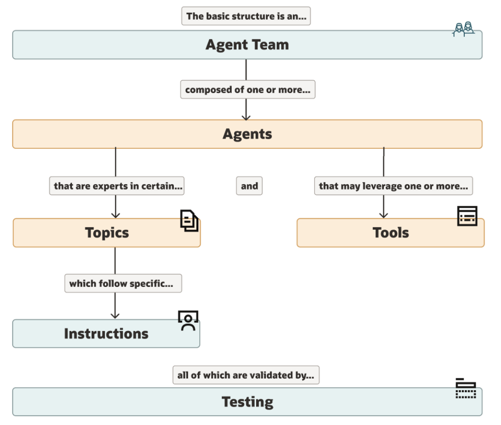

|Component|What It Does|Example|
|---|---|---|
|Agent Team|Consists of a structured sequence of steps or actions that a single agent or a<br>group of agents follows to accomplish a specific business task or answer a user<br>query. The agent team is the component that can be deployed for use.<br> <br>• Consists of conversation logic, system integration, and user support flow.<br>• Defines how the agent acts for a particular use case — what to do, when<br>to do it, and how to respond based on user inputs or back-end system<br>data.|A recruitment agent (that might consist of<br>multiple agents) schedules interviews, screens<br>resumes, calculates salary, and generates<br>offers, based on policies and approvals.|

2

<a id="page-11"></a>

Oracle AI for Fusion Applications
How do I use AI Agent Studio?

Chapter 1
Overview

|Component|What It Does|Example|
|---|---|---|
|Agents|Leverages a large language model to reason, create action plans, and interact<br>with users to gather information and take direction. On behalf of users, the<br>AI agent can do tasks that enhance productivity, efficiency, and the overall<br>user experience. An agent must be added to an agent team, so that it can be<br>deployed for use.<br> <br>AI agents can be categorized into various types.<br> <br>• User-proxy agent: Acts on behalf of a business user to provide input<br>to another agent or group of agents. It's sometimes referred to as a<br>conversational agent.<br>• Supervisor agent: Orchestrates the use of agents within an agentic flow.<br>• Specialist or utility agent: Focuses on a specific role or expertise and can<br>be skilled in using a particular tool.<br>AI agents can also have one or more of these characteristics:<br> <br>• Persona-based agent: Represents a specific role, such as benefits<br>administrator, customer service representative, and finance<br>administrator.<br>• Tool user: Uses technology-related tools, such as calculators, web search<br>queries, document embedding, and calendar schedulers.<br>• Task-oriented agent: Understands their assignment or task, as a single<br>agent or as part of a multiagent flow.|A scheduling or calendar agent that manages<br>your workday by following your instructions. It<br>can accept new calendar invites and propose<br>alternative times when needed.|
|Topics|Defines the areas of expertise through instructions that set the boundaries<br>and constraints for agent conversations and abilities.|An employee benefits agent can contain<br>topics such as Health Savings Account (HSA),<br> retirement benefits, and stock plans.|
|Tools|Defines the additional utilities an agent can use to accomplish a task. One or<br>more tools are assigned to agents, and they're reusable among agents.|• Calculator tool<br>• Email tool<br>• Business object tool<br>• User query tool<br>• Document retrieval tool for retrieval-<br>augmented generation (RAG)|
|Instructions|Specifies the natural language rules that define the rules or conditions applied<br>to a given topic. Instructions are part of the prompts that are sent to the<br>underlying large language model. They can also contain guidelines and<br>guardrails that set the parameters of an agent response.|Instructions for the payroll deduction topic:<br>Make sure you've information regarding the<br>number of dependents either by asking the<br>user or querying the system. If you don't know<br>the answer, don't make up a response.|
|Testing|Enables administrators to test the agent team design, ensure correct tool,<br> topic, and instruction configurations, and validate reasoning and sources cited<br>by the agent.|Provide example responses to a series of<br>questions a user would likely ask an agent<br>and details about how the agent arrived at its<br>response.|

3

<a id="page-12"></a>

Oracle AI for Fusion Applications
How do I use AI Agent Studio?

Chapter 1
Overview

4

<a id="page-13"></a>

Oracle AI for Fusion Applications
How do I use AI Agent Studio?

Chapter 2
[Access Requirements for AI Agent Studio](#page-13)

## **2 [Access Requirements for AI](#page-13) Agent Studio**

#### Access Requirements for AI Agent Studio

You can give access to AI Agent Studio by assigning predefined duty roles to job roles. Also, make sure to complete
these prerequisites:

    - Enable security console to work with permission groups

    - Run scheduled processes to import security data

    - Run scheduled processes to get help from the integrated AI agent

    - (Optional) Assign privilege to use external REST API tools

    - (Optional) Assign permission groups for channels

**[Watch video](http://apex.oracle.com/pls/apex/f?p=44785:265:0::::P265_CONTENT_ID:34612)**

###### Enable Security Console to Work with Permission Groups

For the Security Console to work with permission groups and related objects, set the **Enable Security Console External**
**Application Integration** (ORA_ASE_SAS_INTEGRATION_ENABLED) profile option at the site level.

**1.** In the Setup and Maintenance work area, search for the **Manage Administrator Profile Values** task using the

search link in the panel.
**2.** Search for the profile option and set the value for the **Site** profile level to **Yes** .

###### Run Scheduled Processes to Import Security Data

To import resources from LDAP, and transfer the necessary information into the security tables of Fusion Applications,
run these two scheduled processes sequentially.

**1.** Import Resource Application Security Data
**2.** Import User and Role Application Security Data

You must run the processes one after the other.

**1.** Go to **Navigator**    - **Tools**    - **Scheduled Processes** .
**2.** Click **Schedule New Process** .
**3.** Leave the type as **Job** .
**4.** Search for and select the process.
**5.** Submit the process.

###### Run Scheduled Processes to Get Help from the Integrated AI Agent

You can get answers to questions about developing AI agents from the AI help agent integrated into AI Agent Studio.
Using this conversational agent, you can get answers to questions about existing agents, search for agents, tools, and
topics using natural language, and receive AI powered suggestions for relevant resources to use in your agents.

5

<a id="page-14"></a>

Oracle AI for Fusion Applications
How do I use AI Agent Studio?

To use the integrated AI help agent, run these two scheduled processes daily.

    - Index AI Agent Studio Assistant Documents

    - Index AI Agent Studio Assistant Objects and Attributes

Run each process using these steps:

**1.** Go to Scheduled Processes, and click **Schedule New Process** .
**2.** Leave the type as **Job** .
**3.** Search for and select the process.
**4.** Submit the process.

###### Assign Privilege to Use External REST API Tools

Chapter 2
Access Requirements for AI Agent Studio

To create External REST API tools in AI Agent Studio, the Create and Edit Backends for Visual Builder Studio
(ORA_FND_TRAP_PRIV) privilege must be added to the custom role assigned to the user. You can add this privilege
while creating or editing a custom role.

**1.** Go to the Security Console.
**2.** To use a new custom role, create it. To use an existing custom role, search for the custom role and edit it.
**3.** Go to the Function Security Policies page and select **Add Function Security Policy** .
**4.** Add the Create and Edit Backends for Visual Builder Studio (ORA_FND_TRAP_PRIV) privilege to the role and
save it.
**5.** Save the custom role and assign to the user.

###### Assign Permission Groups for Channels

To create channels from Credentials tab in AI Agent Studio, additional permission groups must be added to the custom
role assigned to the user. You can add these permission groups to a duty role and assign the duty role while creating or
editing a custom role.

**1.** Go to the Security Console and create a new duty role for permission groups.
**2.** Open the **Permission Groups** page and select **Add Permission Groups** .
**3.** Search for and add these permission groups:

      - create:ChannelManifest

      - create:ExternalChatCorrelation

      - delete:ChannelManifest

      - delete:ExternalChatCorrelation

      - read:ChannelManifest

      - read:ExternalChatCorrelation

      - update:ChannelManifest

      - update:ExternalChatCorrelation

**4.** Add security view for each permission group.

**a.** Select the permission group added.
**b.** In Details section, open Security Views tab.

**c.** Select **Add Security Views** and add the **AllRowsAllFields** security view.
**d.** Add the security view for all the permission groups.
**5.** Save the duty role and assign this duty role to the custom job role.

6

<a id="page-15"></a>

Oracle AI for Fusion Applications
How do I use AI Agent Studio?

Chapter 2
Access Requirements for AI Agent Studio

**6.** To use a new custom job role, create it. To use an existing custom job role, search for the custom job role and
edit it.

**Note:** Make sure to enable permission groups.

**7.** Go to the **Role Hierarchy** page. From the Roles and Permission Groups tab select **Add Role** .
**8.** Search for and add the duty role you've created.
**9.** Save the custom role and assign to the user.

###### Assign Predefined Duty Roles to Job Roles

Assign predefined product-specific duty roles to the appropriate job roles, and make sure permission groups are
enabled. You can give people access to configure AI agents in all or specific products.

**CAUTION:** Using predefined roles might account for subscription consumption irrespective of whether you
purchased the cloud service or not. See _[Guidance for Assigning Predefined Roles](https://docs.oracle.com/en/cloud/saas/applications-common/25c/facsa/guidance-for-assigning-predefined-roles-and-privileges.html#u30017042)_ .

    - _[Provide Access to Configure AI Agents in all Products](#page-15)_

    - _[Provide Access to Configure AI Agents in Oracle Fusion Cloud Human Capital Management](#page-16)_

    - _[Provide Access to Configure AI Agents in Oracle Fusion Cloud Supply Chain & Manufacturing](#page-20)_

    - _[Provide Access to Configure AI Agents in Oracle Fusion Cloud Procurement](#page-25)_

    - _Provide Access to Configure AI Agents in Oracle Permitting and Licensing_

#### [Provide Access to Configure AI Agents in all Products](#page-15)

**1.** Go to the Security Console and create a new custom job role.

**Note:** Make sure to enable permission groups.

**2.** On the Role Hierarchy page, open the Roles and Permission Groups tab and add these duty roles:

      - Fai Genai Agent CX Administrator Duty
(ORA_DR_FAI_GENERATIVE_AI_AGENT_CX_ADMINISTRATOR_DUTY)

      - Fai Genai Agent FIN Administrator Duty
(ORA_DR_FAI_GENERATIVE_AI_AGENT_FIN_ADMINISTRATOR_DUTY)

      - Fai Genai Agent GRC Administrator Duty
(ORA_DR_FAI_GENERATIVE_AI_AGENT_GRC_ADMINISTRATOR_DUTY)

      - Fai Genai Agent HCM Administrator Duty
(ORA_DR_FAI_GENERATIVE_AI_AGENT_HCM_ADMINISTRATOR_DUTY)

      - Fai Genai Agent PRC Administrator Duty
(ORA_DR_FAI_GENERATIVE_AI_AGENT_PRC_ADMINISTRATOR_DUTY)

      - Fai Genai Agent PRJ Administrator Duty
(ORA_DR_FAI_GENERATIVE_AI_AGENT_PRJ_ADMINISTRATOR_DUTY)

      - Fai Genai Agent PSC Administrator Duty
(ORA_DR_FAI_GENERATIVE_AI_AGENT_PSC_ADMINISTRATOR_DUTY)

7

<a id="page-16"></a>

Oracle AI for Fusion Applications
How do I use AI Agent Studio?

Chapter 2
Access Requirements for AI Agent Studio

      - Fai Genai Agent SCM Administrator Duty
(ORA_DR_FAI_GENERATIVE_AI_AGENT_SCM_ADMINISTRATOR_DUTY)
**3.** Open the Roles and Privileges tab and add the Manage All Intelligent Agents
(ORA_FAI_MANAGE_ALL_AI_AGENTS) role.
**4.** Save the custom role and assign it to users who want access.

#### Provide Access to Configure AI Agents in Oracle Fusion Cloud Human Capital Management

8

<a id="page-17"></a>

Oracle AI for Fusion Applications
How do I use AI Agent Studio?

Chapter 2
Access Requirements for AI Agent Studio

###### To give access to users without the Human Capital Management Application Administrator Job Role:

**1.** Go to the Security Console and create a new custom job role.

**Note:** Make sure to enable permission groups.


9

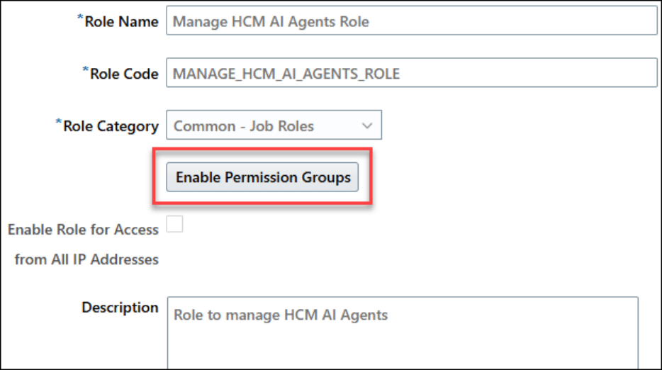

<a id="page-18"></a>

Oracle AI for Fusion Applications
How do I use AI Agent Studio?

**2.** Go to the Role Hierarchy page.

Chapter 2
Access Requirements for AI Agent Studio

   - Open the Roles and Privileges tab, and add the Manage HCM Intelligent Agent
(ORA_HRC_HCM_AI_AGENT_MANAGEMENT_DUTY) duty role.

   - Open the Roles and Permission Groups tab, and add the Fai Genai Agent HCM Administrator Duty
(ORA_DR_FAI_GENERATIVE_AI_AGENT_HCM_ADMINISTRATOR_DUTY) role.

**3.** Save the custom role and assign to the appropriate job roles.

10

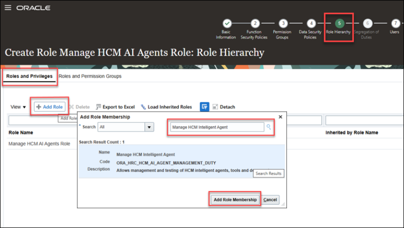

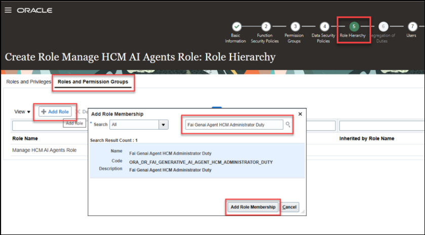

<a id="page-19"></a>

Oracle AI for Fusion Applications
How do I use AI Agent Studio?

Chapter 2
Access Requirements for AI Agent Studio

###### To give access to users with the Human Capital Management Application Administrator Job Role:

**1.** Go to the Security Console and create a new custom job role.

**Note:** Make sure to enable permission groups.

11

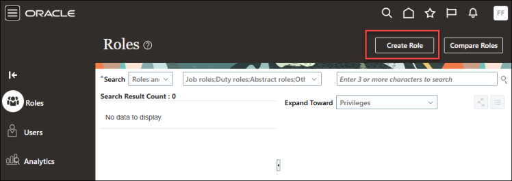

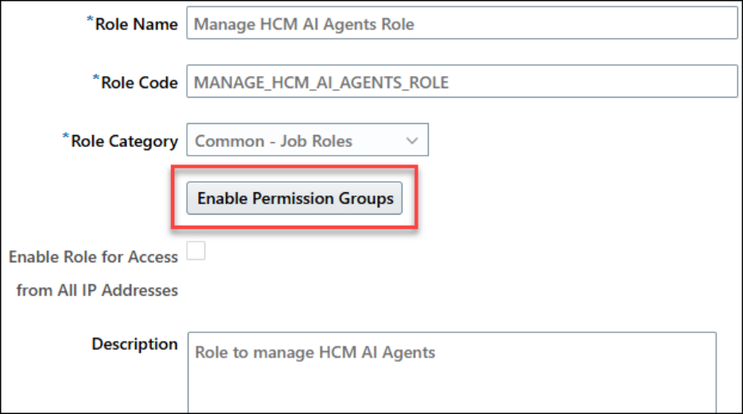

<a id="page-20"></a>

Oracle AI for Fusion Applications
How do I use AI Agent Studio?

Chapter 2
Access Requirements for AI Agent Studio

**2.** On the Role Hierarchy page, open the Roles and Permission Groups tab, and add the Fai Genai Agent HCM
Administrator Duty (ORA_DR_FAI_GENERATIVE_AI_AGENT_HCM_ADMINISTRATOR_DUTY) role.

**3.** Save the custom role and assign to the appropriate job roles.

#### Provide Access to Configure AI Agents in Oracle Fusion Cloud Supply Chain & Manufacturing

###### To give access to users without the Supply Chain Application Administrator Job Role:

**1.** Go to the Security Console and create a new custom job role.

**Note:** Make sure to enable permission groups.

12


<a id="page-21"></a>

Oracle AI for Fusion Applications
How do I use AI Agent Studio?

Chapter 2
Access Requirements for AI Agent Studio

13

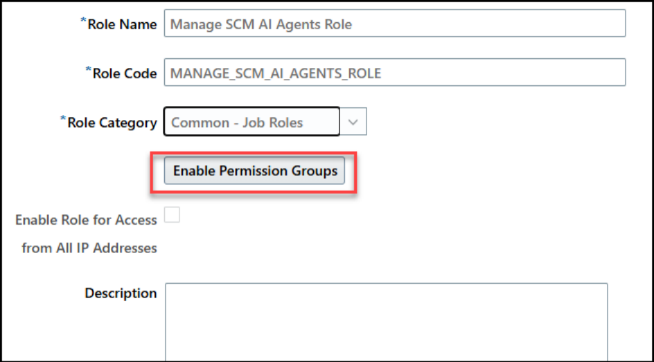

<a id="page-22"></a>

Oracle AI for Fusion Applications
How do I use AI Agent Studio?

Chapter 2
Access Requirements for AI Agent Studio

**2.** On the Role Hierarchy page, open the Roles and Privileges tab and add these roles:

   - SCM Intelligent Agent Management Duty (ORA_RCS_SCM_AI_AGENT_MANAGEMENT_DUTY)

   - SCM Intelligent Agent Management Duty (ORA_RCS_SCM_AI_AGENT_MANAGEMENT_DUTY_HCM)

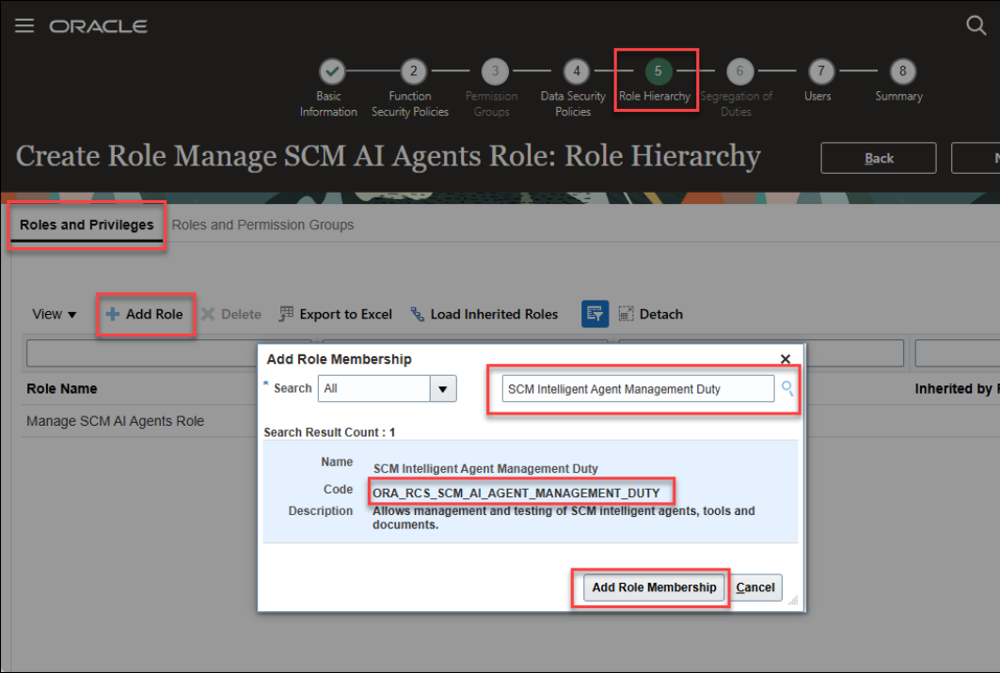

14

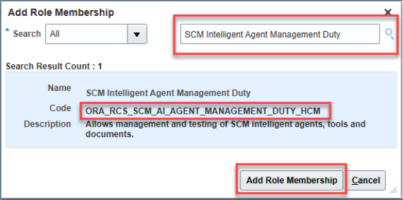

<a id="page-23"></a>

Oracle AI for Fusion Applications
How do I use AI Agent Studio?

Chapter 2
Access Requirements for AI Agent Studio

**3.** Open the Roles and Permission Groups tab and add the Fai Genai Agent SCM Administrator Duty
(ORA_DR_FAI_GENERATIVE_AI_AGENT_SCM_ADMINISTRATOR_DUTY) duty role.

**4.** Save the custom role and assign this custom role to the appropriate job roles.

###### To give access to users with the Supply Chain Application Administrator Job Role:

**1.** Go to the Security Console.

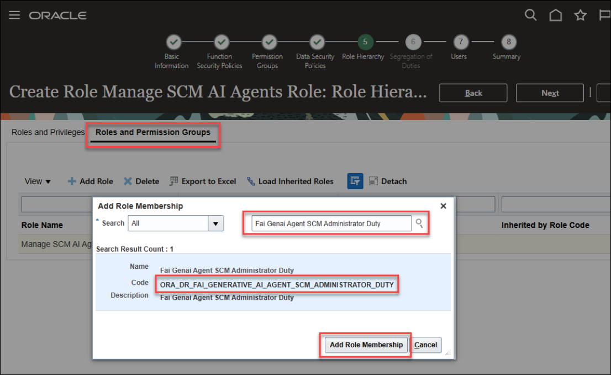

15

<a id="page-24"></a>

Oracle AI for Fusion Applications
How do I use AI Agent Studio?

Chapter 2
Access Requirements for AI Agent Studio

**2.** Search for the Supply Chain Application Administrator
(ORA_RCS_SUPPLY_CHAIN_APPLICATION_ADMINISTRATOR_JOB) job role, and edit it.

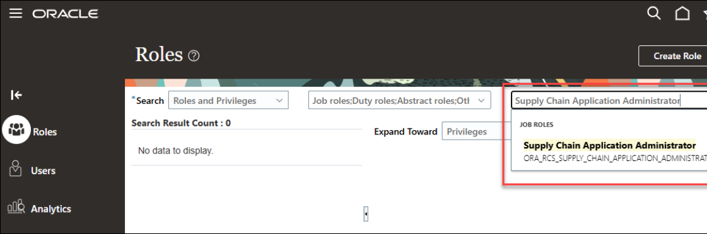

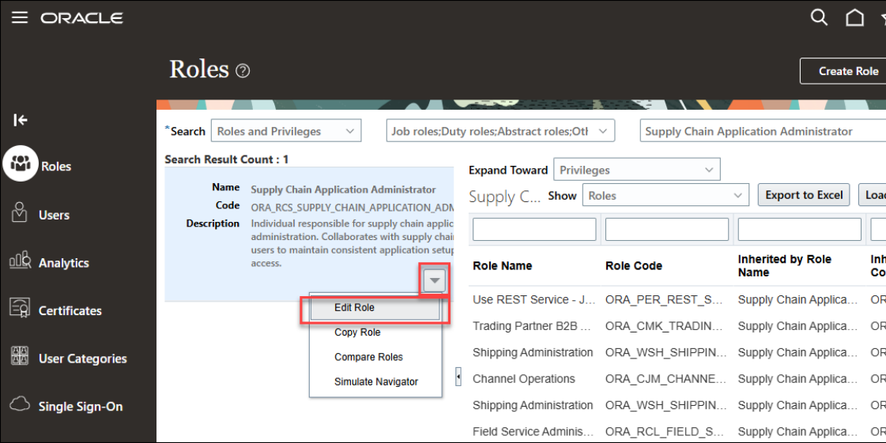

16

<a id="page-25"></a>

Oracle AI for Fusion Applications
How do I use AI Agent Studio?

**3.** Enable permission groups and save the job role.

Chapter 2
Access Requirements for AI Agent Studio

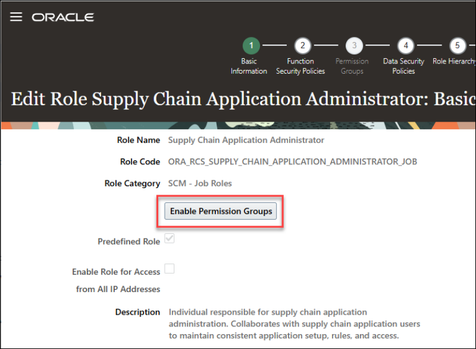
#### Provide Access to Configure AI Agents in Oracle Fusion Cloud Procurement

17

<a id="page-26"></a>

Oracle AI for Fusion Applications
How do I use AI Agent Studio?

Chapter 2
Access Requirements for AI Agent Studio

###### To give access to users without the Procurement Application Administrator Job Role:

**1.** Go to the Security Console and create a new custom job role.

**Note:** Make sure to enable permission groups.

18


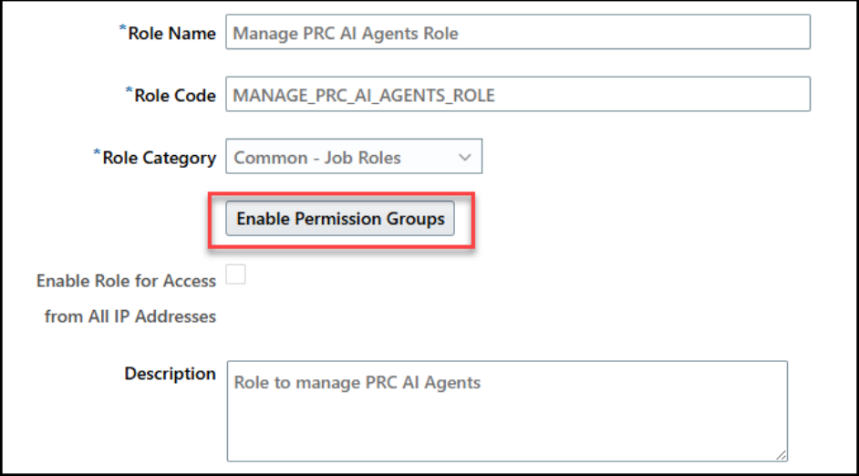

<a id="page-27"></a>

Oracle AI for Fusion Applications
How do I use AI Agent Studio?

Chapter 2
Access Requirements for AI Agent Studio

**2.** On the Role Hierarchy page, open the Roles and Privileges tab and add these roles:

   - PRC Intelligent Agent Management Duty (ORA_PO_PRC_AI_AGENT_MANAGEMENT_DUTY)

   - PRC Intelligent Agent Management Duty (ORA_PO_PRC_AI_AGENT_MANAGEMENT_DUTY_HCM)

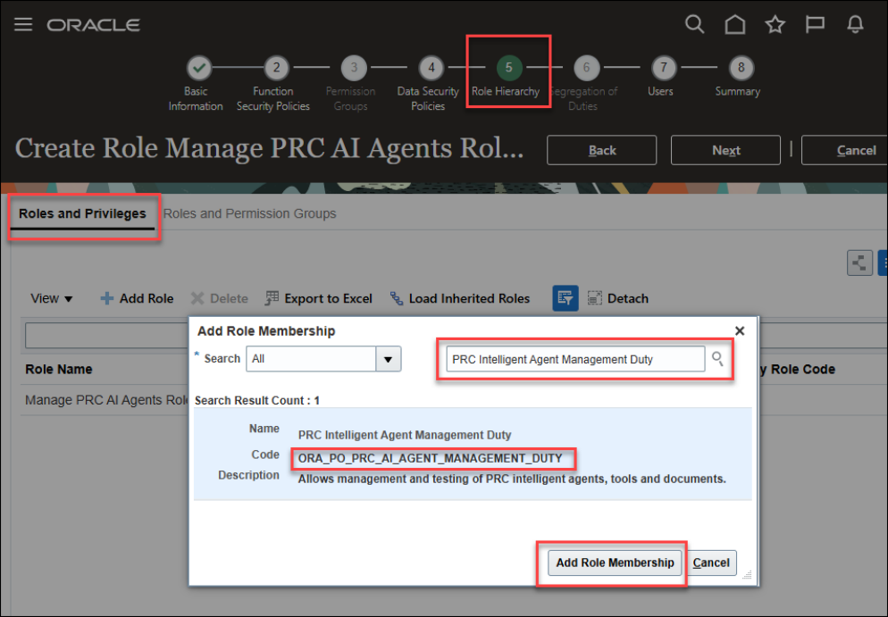

19

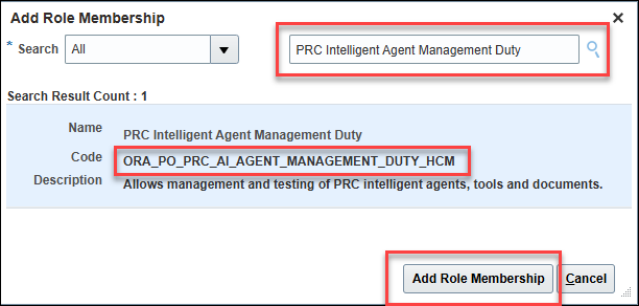

<a id="page-28"></a>

Oracle AI for Fusion Applications
How do I use AI Agent Studio?

Chapter 2
Access Requirements for AI Agent Studio

**3.** Open the Roles and Permission Groups tab and add the Fai Genai Agent PRC Administrator Duty
(ORA_DR_FAI_GENERATIVE_AI_AGENT_PRC_ADMINISTRATOR_DUTY) duty role.

**4.** Save the custom role and assign this custom role to the appropriate job roles.

###### To give access to users with the Procurement Application Administrator Job Role:

**1.** Go to the Security Console.

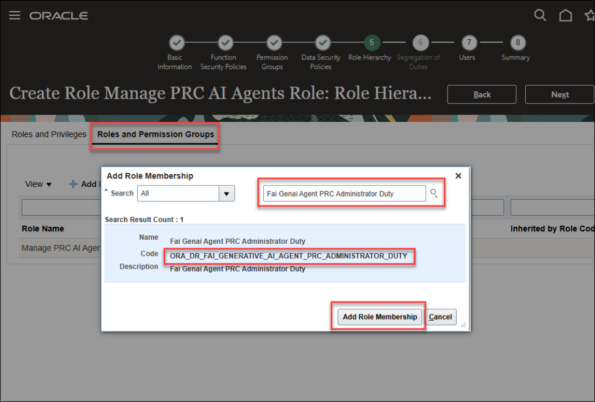

20

<a id="page-29"></a>

Oracle AI for Fusion Applications
How do I use AI Agent Studio?

Chapter 2
Access Requirements for AI Agent Studio

**2.** Search for the Procurement Application Administrator (ORA_PO_PROCUREMENT_APPLICATION_ADMIN_JOB)
job role, and edit it.

21

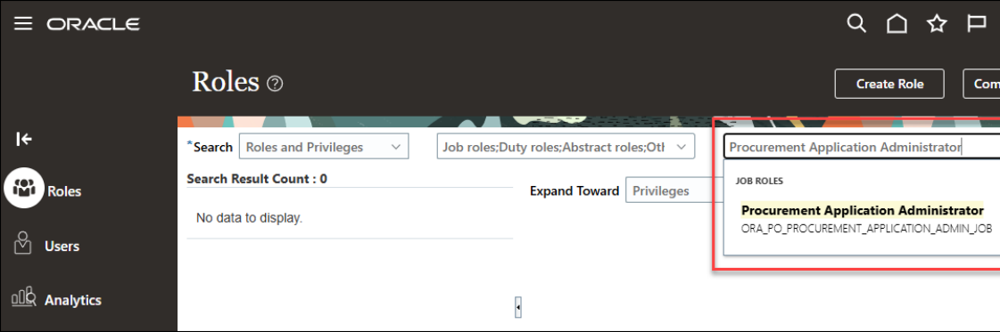

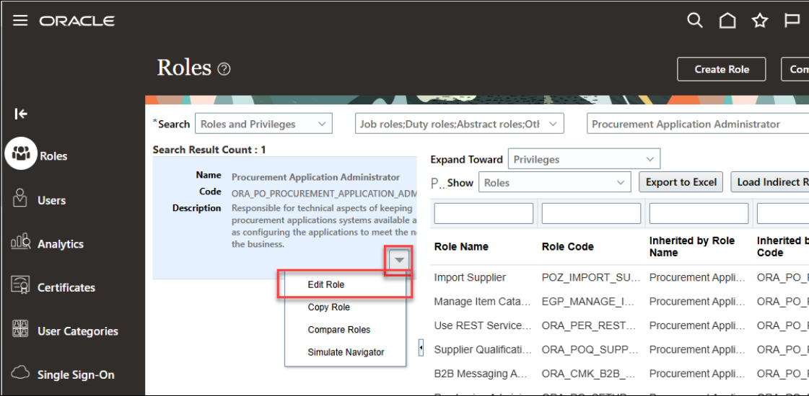

<a id="page-30"></a>

Oracle AI for Fusion Applications
How do I use AI Agent Studio?

**3.** Enable permission groups and save the job role.

Chapter 2
Access Requirements for AI Agent Studio

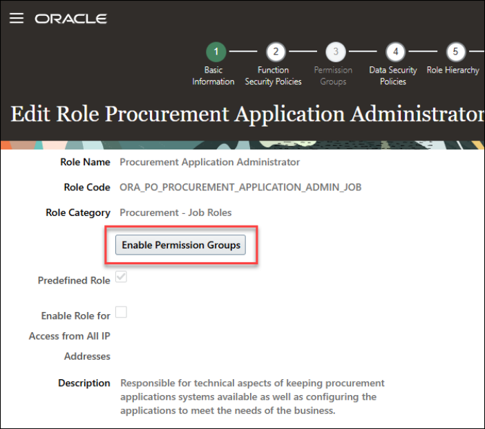
#### Provide Access to Configure AI Agents in Oracle Fusion Cloud Financials

**1.** Go to the Security Console and create a new custom job role.

**Note:** Make sure to enable permission groups.

**2.** Go to the Role Hierarchy page.

      - Open the **Roles and Privileges** tab, and add the Manage Financials Intelligent Agent
(ORA_FUN_MANAGE_FIN_AI_AGENT_HCM) and Manage Financials Intelligent Agent
(ORA_FUN_MANAGE_FIN_AI_AGENT) duty roles.

      - Open the **Roles and Permission Groups** tab, and add the Fai Genai Agent FIN Administrator Duty
(ORA_DR_FAI_GENERATIVE_AI_AGENT_FIN_ADMINISTRATOR_DUTY) duty role.
**3.** Save the custom role and assign it to the appropriate job roles.

22

<a id="page-31"></a>

Oracle AI for Fusion Applications
How do I use AI Agent Studio?

Chapter 2
Access Requirements for AI Agent Studio

#### Provide Access to Configure AI Agents in Oracle Fusion Cloud CX

###### To give access to users without the Sales Administrator Job Role:

**1.** Go to the Security Console and create a new custom job role.

**Note:** Make sure to enable permission groups.

**2.** On the Role Hierarchy page, open the Roles and Privileges tab and add these roles:

      - Manage CX AI Agents (ORA_ZCA_MANAGE_CX_AI_AGENTS)

      - Manage CX AI Agents (ORA_ZCA_MANAGE_CX_AI_AGENTS_HCM)

**3.** Open the Roles and Permission Groups tab and add the Fai Genai Agent CX Administrator Duty
(ORA_DR_FAI_GENERATIVE_AI_AGENT_CX_ADMINISTRATOR_DUTY) duty role.
**4.** Save the custom role and assign this custom role to the appropriate job roles.

###### To give access to users with the Sales Administrator Job Role:

**1.** Go to the Security Console and search for the Sales Administrator (ORA_ZBS_SALES_ADMINISTRATOR_JOB)
job role, and edit it.
**2.** Enable permission groups and save the job role.

#### Provide Access to Configure AI Agents in Oracle Permitting and Licensing

23

<a id="page-32"></a>

Oracle AI for Fusion Applications
How do I use AI Agent Studio?

Chapter 2
Access Requirements for AI Agent Studio

###### To give access to users without the PSC Application Administrator Job Role:

**1.** Go to the Security Console and create a new custom job role.

**Note:** Make sure to enable permission groups.


24

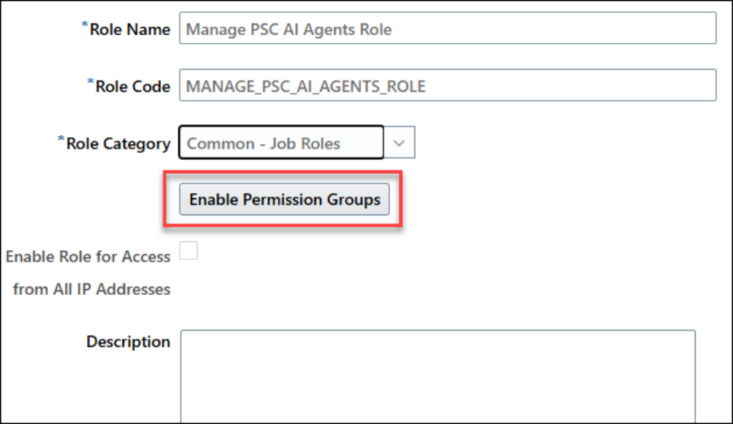

<a id="page-33"></a>

Oracle AI for Fusion Applications
How do I use AI Agent Studio?

Chapter 2
Access Requirements for AI Agent Studio

**2.** On the Role Hierarchy page, open the Roles and Privileges tab and add these roles:

   - PSC Intelligent Agent Management (ORA_PSC_AI_AGENT_MANAGEMENT_DUTY)

   - PSC Intelligent Agent Management (ORA_PSC_AI_AGENT_MANAGEMENT_DUTY_HCM)

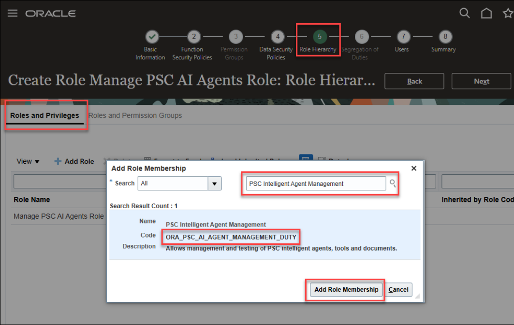

25

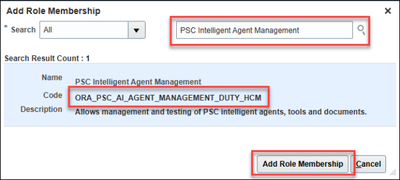

<a id="page-34"></a>

Oracle AI for Fusion Applications
How do I use AI Agent Studio?

Chapter 2
Access Requirements for AI Agent Studio

**3.** Open the Roles and Permission Groups tab and add the Fai Genai Agent PSC Administrator Duty
(ORA_DR_FAI_GENERATIVE_AI_AGENT_PSC_ADMINISTRATOR_DUTY) duty role.

**4.** Save the custom role and assign this custom role to the appropriate job roles.

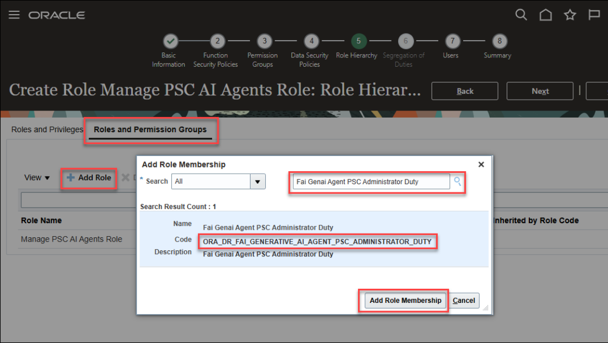

26

<a id="page-35"></a>

Oracle AI for Fusion Applications
How do I use AI Agent Studio?

Chapter 2
Access Requirements for AI Agent Studio

###### To give access to users with the PSC Application Administrator Job Role:

**1.** Go to the Security Console and create a new custom job role.

**Note:** Make sure to enable permission groups.


27

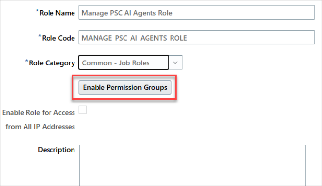

<a id="page-36"></a>

Oracle AI for Fusion Applications
How do I use AI Agent Studio?

Chapter 2
Access Requirements for AI Agent Studio

**2.** On the Role Hierarchy page, open the Roles and Permission Groups tab and add the Fai Genai Agent PSC
Administrator Duty (ORA_DR_FAI_GENERATIVE_AI_AGENT_PSC_ADMINISTRATOR_DUTY) duty role.

**3.** Save the custom role and assign this custom role to the appropriate job roles.

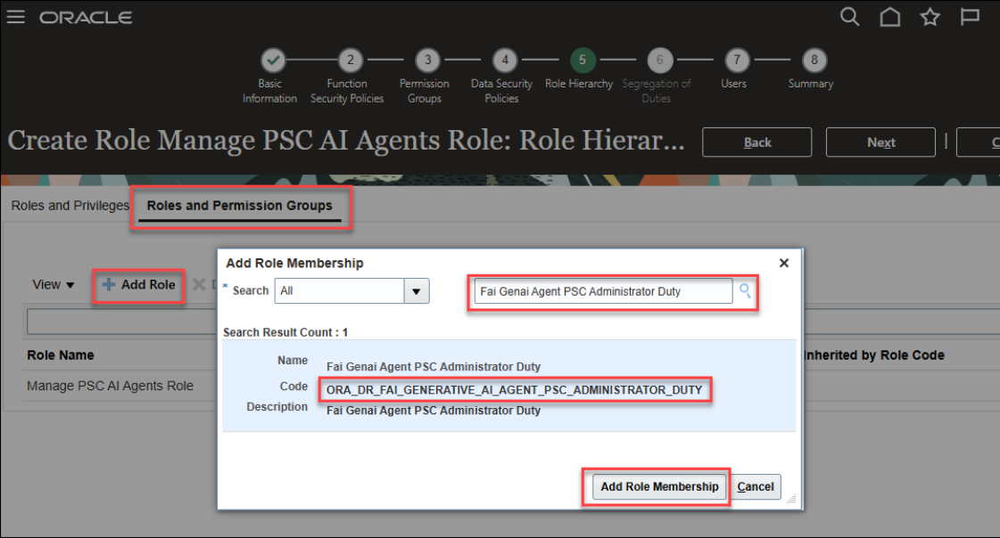

28

<a id="page-37"></a>

Oracle AI for Fusion Applications
How do I use AI Agent Studio?

## **3 Before You Begin**

#### Choose How to Create AI Agents

Chapter 3
Before You Begin

You can either use one of the preconfigured templates or create custom agents. If you want to create new agents or
modify existing agents by adding additional tools and topics, a subscription is required. For more information, see
_[Fusion Custom AI Agents - Pricing FAQ (KB864473)](https://support.oracle.com/support/?documentId=KB864473)_ .

Here are some examples of how you choose between creating custom agents or using preconfigured templates, based
on your use case.

|Use Case|How to Create AI Agents|
|---|---|
|You want to turn on Benefits Agent, which<br>allows employees to ask questions about<br>their benefits, within AI Agent Studio. To<br>ensure that this agent can understand the<br>benefits specific to the organization, the<br>documents specific to that organization<br>must be uploaded.|Create an AI agent using a preconfigured agent team template. You can edit the existing agent, without<br>adding any additional tools.<br> <br>**Note:** You can either use or copy a template and edit it. When you copy an agent template, you can<br>automatically add a suffix to all the components to easily differentiate them.|
|You want to create a custom agent to help<br>with onboarding by answering new hire<br>questions and providing deep links to<br>internal new hire resources if the agent<br>is unable to answer. You can tailor the<br>agent's topics and prompts to ensure they<br>effectively address the specific needs of<br>new hires.|Create a custom agent, and add the necessary tools and topics.|
|You want to create a Contract Assistant<br>Agent to generate a new contract with<br>auto-filled fields. This assistant will be<br>provided with multiple contract templates<br>to generate the new contract. The agent<br>also reviews existing contracts to perform<br>risk analysis, recommend changes and<br>route the contract for final approvals.<br>For these activities that need distinct<br>expertise (template management, legal<br>validation, recommendation, and routing),<br>the administrator will need to build a<br>supervisor agent that collaborates with<br>other worker agents.|You can use either of these methods:<br>• Create a team of custom agents, with one agent added as a supervisor to manage the others.<br>• Use a preconfigured agent team template, and add more agents and a supervisor agent to it.|

29

<a id="page-38"></a>

Oracle AI for Fusion Applications
How do I use AI Agent Studio?

Chapter 3
Before You Begin

|Use Case|How to Create AI Agents|
|---|---|
|You want to create a Supplier Quote<br>Assistant agent to parse through quotes<br>from multiple suppliers. The agent<br>processes the quote document and maps<br>the attributes. It then creates a draft<br>requisition and submits for approval. For<br>these activities, administrator will need to<br>create a workflow agent that runs the tasks<br>in the specified order.|Create an agent team of type Workflow, to run the predetermined set of tasks. Each node can perform<br>a defined function, for example, extracting data, calling a business object, running an LLM, or sending<br>an email in the order you define.|

#### Get Started with AI Agent Studio

You can start with a preconfigured agent template or create your own agent team.

When using a preconfigured agent team template, the artifacts such as agents, tools, and topics, aren't directly editable.
To change these artifacts, you create a copy of the artifact and add the copy to the agent team.

**Note:** Agents created directly within an agent team are directly editable within that team.

Here's a broad outline of the tasks involved in creating an agent team.

|Task|Details|
|---|---|
|Define tools|To effectively define the tools required by an agent, you need to first identify the types of questions<br>users might ask and then decide which tools the agent needs to answer those questions accurately.<br>These are the available tools:<br> <br>• Oracle Fusion Cloud Applications business object: Business Object tools allow AI agents to<br>retrieve, update, create, or delete business object records within Fusion Applications. Using this<br>tool, agents can securely access information or call specific functions in the application. You<br>can control what data the agents can access, by selecting the business objects and fields to<br>use or ignore. AI agents adhere to the native security and role-based access controls of Fusion<br>Applications, ensuring protection and privacy for your enterprise data.<br>• Document tool: You can upload specific documents to be used by the AI agent, and provide<br>natural language instructions on how the agent should use these documents. The agent can then<br>search for information in the documents to provide a more exact answer to a user's question.<br>• Email: This tool can access the email client to send emails that include summaries of interactions<br>or details pulled from a knowledge store.<br>• Deep link: A deep link will send a user directly to the part of Fusion Applications where they can<br>update underlying information. For example, if the user moved and wants to update their home<br>address in the HR system, a deep link can quickly route the user to the page for making that<br>update.<br>• External REST: You can connect to internal and external SaaS applications or public APIs using<br>External REST tool. To connect to internal and third-party services, add the authorization|

30

<a id="page-39"></a>

Oracle AI for Fusion Applications
How do I use AI Agent Studio?

Chapter 3
Before You Begin

|Task|Details|
|---|---|
||parameters. For example, you can retrieve the real-time weather information for a specific<br>location by creating an External REST tool that connects to the appropriate external API.<br>• MCP: You can use the Model Context Protocol (MCP) tool and securely connect to external MCP<br>servers, without building additional REST wrappers or plugin logic.|
|Define topics|Topics define the focus of the agent to a specific area of expertise. They are prompts that you can<br>reuse across multiple systems or summarization prompts. For example, within a Benefits Administrator<br>agent, we might define topics such as health policy coverage, vision policy coverage, and benefits<br>enrollment.<br> <br>Use Topics to efficiently streamline your interactions with the agent.<br> <br>• Specify the instructions that help the agent decide which tools to use.<br>• Enable the agent to better understand user intent by letting it identify and select the relevant<br>topic based on the user's question.<br>• Give each topic a clear, specific name, and include natural language instructions to ensure it's<br>used correctly.<br>You can reuse topics across agents.<br>|
|Define credentials|To enable access to more services, you need to provide the necessary connection credentials. You can<br>add credentials for this artifact:<br> <br>Custom LLM: In addition to the LLMs provided by Oracle, you can use other LLMs you've access to. You<br>can add credentials for your LLM, and select it while creating your agent, node, or agent team.|
|Build new agents|Define the capabilities and scope of the agent.<br> <br>• Agent name<br>• Product area the agent will work in<br>• Natural language instructions to allow the agentic flow, or other agents, to understand the<br>capabilities of this particular agent<br>• Tools and topics the agent will need to use. In addition to the tools and topics you created, you<br>can also add the predefined ones. In the Tools and Topics tabs, the predefined tools and topics are<br>indicated by the<br> icon.|
|Add a user (human) in the loop|If required, add an approval step for some actions that your AI agent will perform. The review step can<br>be added at any point in the process for oversight and control over key actions, such as sending an<br>email or updating a record.|
|Build the agent team|Create an agent team and add agents and other artifacts to it. Types of agent teams are:<br> <br>• Supervisor: A supervisor agent manages other agents and artifacts in the agentic flow.<br>• Workflow: An agentic flow that does the tasks in a predetermined order. Agents and artifacts<br>are added as nodes in the workflow, and each node performs a defined function, for example,<br> extracting data, calling a business object, running an LLM, or sending an email. The node then<br>passes its output to the next step.|

31

<a id="page-40"></a>

Oracle AI for Fusion Applications
How do I use AI Agent Studio?

Chapter 3
Before You Begin

|Task|Details|
|---|---|
||**Note:** You can also add predefined agents to your agent team. In the Agents tab, the predefined<br>agents are indicated by the<br> icon.|
|Test the agents|Make sure to test the agent before deploying to production. Ask a test query, and determine the<br>accuracy and relevance of the agent's response. You can also see the instructions the agent is<br>following, and the actions the agent has taken to arrive at the response.|
|Deploy the agent team|After defining and testing your agent team, you can deploy it directly from AI Agent Studio.<br> <br>• Embed the agent conversation chat experience into any website or application.<br>• Trigger the agent from an external resource using Webhooks, or seamlessly embed the chat<br>experience into HTML and React web pages.|

**Migrate RAG Agents to AI Agent Studio**

If you've previously created any RAG agents in Fusion Applications, we recommend replacing your existing agent with a
new one created in AI Agent Studio. For more information, see _Migrate Document Tools of RAG Agents_ .

#### Add External REST Tool

You can enable your agents to securely connect to internal or external SaaS applications and public APIs by adding
External REST tools in AI Agent Studio. Make sure you have a role with the Create and Edit Backends for Visual Builder
Studio (ORA_FND_TRAP_PRIV) privilege assigned to it.

**1.** Go to **AI Agent Studio** .
**2.** From the Tools tab, click **Add** .
**3.** Add a new tool of type **External REST** .
**4.** Enter the name, code, and description for the tool, and select the appropriate family and product.
**5.** Select **Require Human Approval** to ensure that a person reviews and approves any action before the tool runs.

**a.** Message: Enter instructions for the reviewer.
**b.** Actions: Select the required action.
**6.** In the Authorization tab, add connection details for the third-party service.

**a.** Instance URL: Enter the base domain of the external API, with no paths, parameters, or trailing slashes.
For example, _[https://api.weather.gov]([https://api.weather.gov](https://api.weather.gov))_ is correct.
**b.** Authentication: Define how your agents will authenticate with the external system.

**c.** Description: Provide details about the tool, including what the tool does, and when the agent must call
the tool.
**7.** In the Functions tab, provide endpoint details.

**a.** Name: Assign a unique name to this endpoint. For example, **getWeatherByCoordinates** .
**b.** Operation Type: Select the HTTP method required to process the REST call against the target endpoint.

**c.** Resource Path: Specify the relative resource path to be appended to the Instance URL. Don't include the
protocol or base domain. For example, **/points/{latitude},{longitude}** is correct.
**d.** Description: Provide a clear summary of the endpoint's function and the specific task it performs within
the workflow.

32

<a id="page-41"></a>

Oracle AI for Fusion Applications
How do I use AI Agent Studio?

Chapter 3
Before You Begin

**8.** In the Parameters tab, define each dynamic variable in the path, including data type and purpose. For example,
you can define latitude as the first parameter and longitude as the second.
**9.** In the Sample Queries tab, list example user queries that should trigger this tool.
**10.** In the Headers tab, specify any required metadata and security credentials for the external server.

The tool now appears in the Tools tab, and you can select it when creating agents, nodes, or agent teams.

#### Add MCP Tool

Using Model Context Protocol (MCP) tool, you can securely connect to external MCP servers, and use their capabilities
inside agents and nodes, without building additional REST wrappers or plugin logic.

**1.** Go to **AI Agent Studio** and open the Tools tab.
**2.** Add a new tool of type **MCP** .
**3.** Enter the name, code, and description for the tool, and select the appropriate family and product.
**4.** Add MCP server connection details.

      - Instance URL: Enter the endpoint URL of the MCP server your agent will connect to.

      - Transport Type: Select the communication method:

**-** Server Sent Events (SSE): Enables real-time, one-way streaming of data from a server to a client.

**-** StreamableHTTP: Enables servers to independently handle multiple client connections using the
HTTP POST and GET requests.

      - Credential Type: Select the authentication method required by the MCP server.

**5.** Update the details and create the tool.

Your tool now appears in the Tools tab, and you can select it when creating agents, nodes, or agent teams.

#### Add Your LLM

In addition to the LLMs provided by Oracle that are available for selection when creating an agent, node, or agent team,
you can also use other LLMs by adding the credentials for it. These are the providers you can choose to add.

    - OpenAI (through Microsoft Azure)

    - Google Gemini (through Google Vertex AI)

    - Google Gemini (through direct API)

    - Anthropic (through Google Vertex AI)

To add the LLM, do these steps:

**1.** Go to **AI Agent Studio** and open the Credentials tab.
**2.** In the LLM tab, add the API key.
**3.** Add the details for the provider and save it.

      - Model: Choose the model you need from the available options.

33

<a id="page-42"></a>

Oracle AI for Fusion Applications
How do I use AI Agent Studio?

      - API Key: Add the API key for the selected model.

      - Basic URL: Enter the URL to send LLM requests to.

Chapter 3
Before You Begin

Your LLM now appears in the LLM tab, and you can select it when creating agents, nodes, or agent teams.

34

<a id="page-43"></a>

Oracle AI for Fusion Applications
How do I use AI Agent Studio?

## **4 Use Cases**

#### [Use Cases for Agents of Type Supervisor](#page-43)

##### Single Agent with Multiple Workers

Chapter 4
Use Cases

In this pattern, a Benefits Advisor acts as a central agent, helping employees understand and make the most of their
benefits packages. The agent coordinates several specialized workers to provide a personalized support for medical,
dental, and vision coverage.

    - The **Benefits Advisor** agent serves as the initial contact, helping the employee understand their benefits, and
answers any preliminary questions.

    - The **Policy Information** worker provides the employee with detailed information on available medical, dental,
and vision benefits.

    - The **Personal Enrollment** worker uses the employee’s enrollment details to offer tailored advice on how they
can optimize their benefits package.

    - The **Eligibility and Assistance** worker answers any additional queries regarding eligibility, coverage, helping to
resolve issues related to benefits.

35

<a id="page-44"></a>

Oracle AI for Fusion Applications
How do I use AI Agent Studio?

##### Single Agent with Multiple Tools and a Human in the Loop

Chapter 4
Use Cases

36

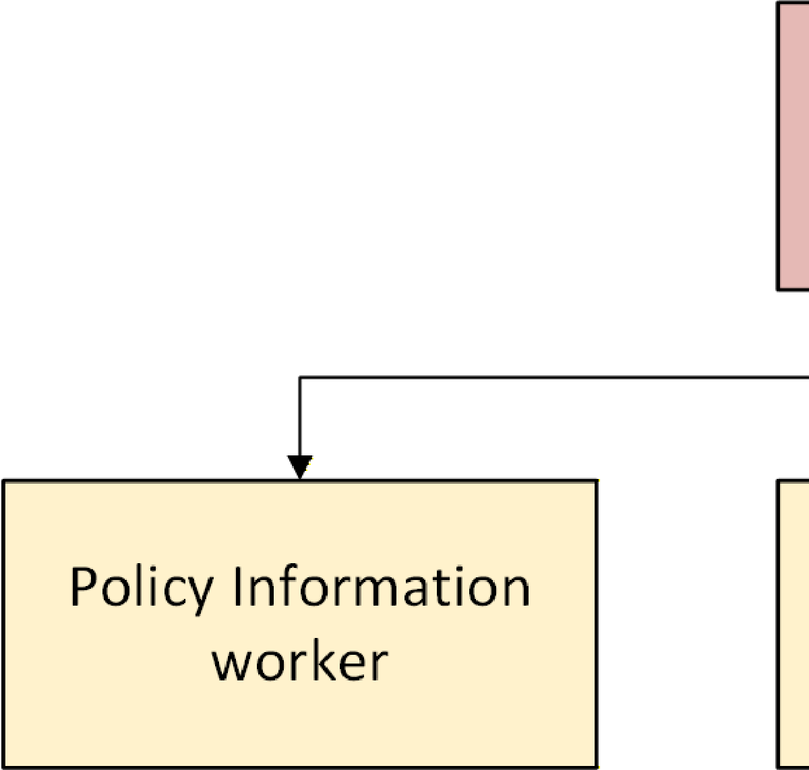

<a id="page-45"></a>

Oracle AI for Fusion Applications
How do I use AI Agent Studio?

Chapter 4
Use Cases

This pattern shows the Benefits Advisor as a central agent that helps employees understand and optimize their benefits.
This agent coordinates specialized workers to provide personalized insights on medical, dental, and vision coverage.

    - The **Benefits Advisor** agent starts the interaction with a friendly introduction and asks for the employee's
needs regarding benefits.

    - The **Company Benefits Database** tool retrieves information on the company’s benefits policies, eligibility, and
plan details.

    - The **Employee Enrollment Data** tool uses the employee’s personal enrollment information to provide tailored
advice, helping them understand and optimize their coverage.

    - The **Benefits Optimizer** tool analyzes the employee’s selections and offers personalized suggestions for
improvement.

    - The _Human-in-the-Loop_ flag determines whether a user must provide explicit approval before the agent
retrieves sensitive data, such as salary or personal information.

37

<a id="page-46"></a>

Oracle AI for Fusion Applications
How do I use AI Agent Studio?

##### Multiple Agents With Multiple Tools and Delegations

Chapter 4
Use Cases

38

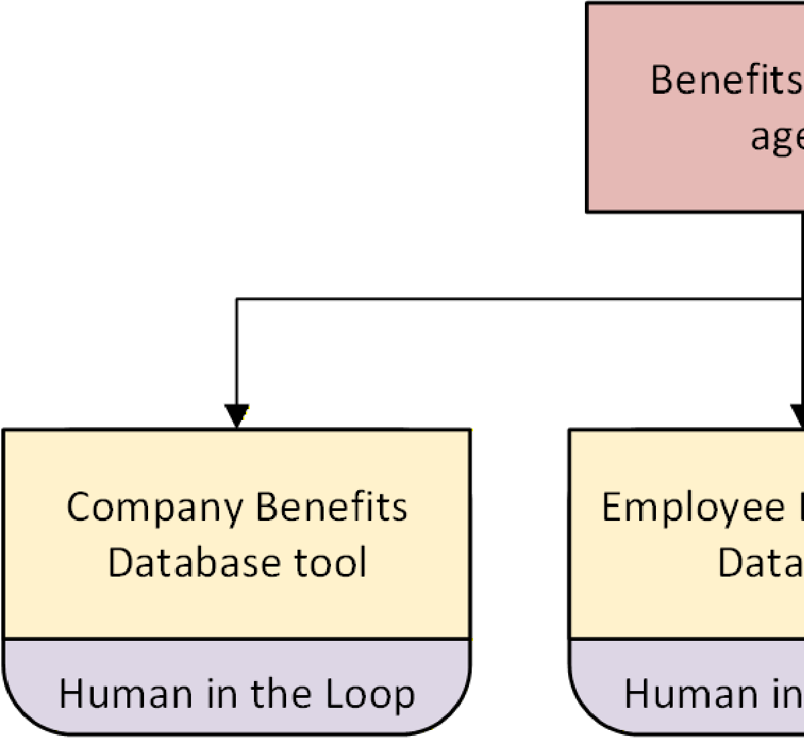

<a id="page-47"></a>

Oracle AI for Fusion Applications
How do I use AI Agent Studio?

Chapter 4
Use Cases

In this pattern, the Central Onboarding Assistant agent acts as a supervisor, guiding new employees through their onboarding process. The supervisor agent delegates tasks to specialized agents, each focused on a specific aspect of onboarding, supported by dedicated workers.

|Agent|Description|
|---|---|
|Policy and Compliance Agent|This agent helps employees understand and comply with company policies, and is<br>supported by these workers.<br> <br>• **Policy Overview worker:** Shares key policies like leave, dress code, and workplace behavior.<br>• **Compliance Training worker:** Provides access to mandatory training. For example, safety and social<br>media policies.<br>• **Document Management worker:** Ensures the employee completes and submits all required forms,<br>such as tax forms and nondisclosure agreements.|
|Cultural Integration Agent|This agent helps employees adapt to the company’s culture and connect with teams,<br>and is supported by these workers.<br> <br>• **Company Values worker:** Explains the vision, mission, and goals of the organization.<br>• **Community Introduction worker:** Connects employees with internal groups, events, and networking<br>opportunities.<br>• **Workplace Norms worker:** Provides guidance about unwritten rules, such as communication<br>etiquette and meeting culture.|
|Tools and Resources Agent|This agent ensures that employees have access to tools, systems, and knowledge<br>required for their job, and is supported by these workers.<br> <br>• **Account Setup worker:** Helps employees set up email, communication tools, and HR platforms.<br>• **Resource Guide worker:** Provides access to handbooks, FAQs, and internal documentation.<br>• **Technical Support worker:** Troubleshoots issues with tools or platforms.|

**Process**

    - The Central Onboarding Assistant agent acts as the entry point that gathers basic information about the
employee’s role and specific needs, and delegates tasks to specialized agents based on the query.

    - The Policy and Compliance agent handles queries, or tasks, related to company rules and legal documentation,
such as, “What’s the process for requesting leave?”

    - The Cultural Integration agent handles queries that focus on helping employees feel part of the team and
aligned with the company values, such as, “How do I join company events?”

    - The Tools and Resources agent handles queries about gaining access to systems and essential knowledge, such
as, “How do I log into the time-tracking tool?"

39

<a id="page-48"></a>

Oracle AI for Fusion Applications
How do I use AI Agent Studio?

Chapter 4
Use Cases

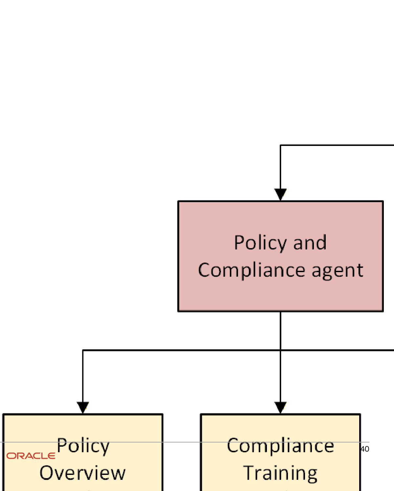

<a id="page-49"></a>

Oracle AI for Fusion Applications
How do I use AI Agent Studio?

##### Product-Specific Use Case Examples

**Oracle Fusion Cloud CX**

Chapter 4
Use Cases

|Agent Type|Key Characteristics|When to Use|Example|
|---|---|---|---|
|Customer service<br>agent|• Interactive<br>• Rule-based<br>• Escalation-friendly<br>• Customer-focused|• Repetitive, high-volume<br>queries<br>• Customer support<br>• Query resolution|Chatbot for customer support<br>agent answers FAQs and<br>resolves issues.|
|Learning agent|• Adaptive<br>• Feedback-driven<br>• Continuously improves<br>• Explainable|• Adaptive systems<br>• Chatbot improvement<br>• Demand forecasting<br>refinement|Chatbot improvement agent<br>learns from customer feedback<br>to improve responses.|

**Oracle Fusion Cloud HCM**

|Agent Type|Key Characteristics|When to Use|Example|
|---|---|---|---|
|Copilots|• Collaborative<br>• Proactive<br>• Decision-making<br>• Domain-specific|• Complex tasks requiring<br>expertise<br>• Draft documents<br>• Input validation|Hiring copilot agent helps to<br>build job descriptions and<br>suggests interview questions.|
|Document referencing<br>agent|• Knowledge-intensive<br>• Accurate<br>• Up-to-date<br>• Query-driven|• Knowledge-intensive tasks<br>• Answers to policy or FAQ<br>questions<br>• Compliance checks|Benefits agent answers<br>employee questions about<br>benefits.|
|Evaluating agent|• Assessment-focused<br>• Criteria-based<br>• Actionable insights<br>• Feedback-driven|• Performance evaluation<br>• Candidate ranking<br>• Feedback analysis|Candidate evaluation agent<br>ranks candidates based on<br>interview performance.|
|Scheduling agent|• Task-oriented<br>• Reactive<br>• Limited decision-making<br>• User-centric|• Routine task scheduling<br>• Calendar management<br>• Appointment booking|Interview scheduling agent<br>coordinates availability<br>between candidates and hiring<br>managers.|
|Task automation agent|• Repetitive task handler<br>• Efficient<br>• Error-resistant|• Repetitive, high-volume<br>tasks<br>• Payroll processing|Payroll processing agent<br>automates time sheet<br>collection and payslip<br>generation.|

41

<a id="page-50"></a>

Oracle AI for Fusion Applications
How do I use AI Agent Studio?

|Agent Type|Key Characteristics|When to Use|Example|
|---|---|---|---|
||• Trigger-based|• Form generation||

**Oracle Fusion Cloud SCM**

Chapter 4
Use Cases

|Agent Type|Key Characteristics|When to Use|Example|
|---|---|---|---|
|Collaborative workflow<br>agent|• Multi-stakeholder<br>• Real-time coordination<br>• Role-based task allocation<br>• Communication-driven|• Complex processes<br>requiring collaboration<br>• Supplier collaboration<br>• Crisis management|Supplier collaboration agent<br>coordinates with procurement,<br>supplier, and warehouse bots<br>to work together.|
|Decision-making<br>agent|• Data-driven<br>• Recommendation-focused<br>• Transparent<br>• Adaptive|• Data-driven tasks<br>• Supplier evaluation<br>• Candidate shortlisting|Supplier evaluation agent<br>evaluates suppliers based on<br>cost and quality.|
|Goal-seeking agent|• Optimization-focused<br>• Real-time adjustments<br>• Objective-driven<br>• Explainability|• Resource allocation<br>• Route planning<br>• Workforce scheduling|Route optimization agent plans<br>optimal delivery routes.|
|Monitoring agent|• Proactive<br>• Alert-driven<br>• Data-intensive<br>• Response-oriented|• Proactive management<br>• Inventory monitoring<br>• Social media tracking|Inventory monitoring agent<br>tracks in-stock levels and alerts<br>for replenishment.|

42

<a id="page-51"></a>

Oracle AI for Fusion Applications
How do I use AI Agent Studio?

## **5 Create AI Agents**

Chapter 5
Create AI Agents

#### Create AI Agents Using Preconfigured Templates

You can create and deploy AI agents using preconfigured templates available in these two tabs:

    - AI Agents: Access the preconfigured templates built and provided by Oracle. When using a preconfigured agent
team template, the artifacts such as agents, tools, and topics aren't directly editable. To change these artifacts,
you create a copy of the artifact and add the copy to the agent team.

    - Marketplace: Access the preconfigured templates built and provided by Oracle partners. View template details
using the icon. To create a copy of any template, click **Create** .

To use preconfigured agent team templates from the AI Agents tab:

**1.** Go to **AI Agent Studio** .
**2.** Select **Use Template** from the required agent team and provide details for the new agent team.

**Tip:** To automatically add a suffix to your agent team, choose **Copy Template** instead of **Use Template** .

**Details Tab**

|Field|Description|
|---|---|
|Family|Select the family to which this agent team belongs.|
|Product|Select the product within the family to which this agent team belongs.|

43

<a id="page-52"></a>

Oracle AI for Fusion Applications
How do I use AI Agent Studio?

Chapter 5
Create AI Agents

|Field|Description|
|---|---|
|Maximum Interactions|Indicate the number of times an agent within this agent team can interact with the topics and<br>tools assigned to it.|

**LLM Tab**

|Field|Description|
|---|---|
|Provider|Select the LLM for your agent.|

**Security Tab**

|Field|Description|
|---|---|
|Add|Select the roles which will have access to this agent team.|

**Questions Tab**

|Field|Description|
|---|---|
|Starter Questions|Enter initial questions for the agent team.|
|Follow-up Questions|Enable this to indicate that the agent team can ask follow-up questions based on the user's<br>conversation history.|
|Prompt|Enter the prompt to be used for the follow-up questions. For example:<br>**using {chatHistory} generate 3 follow up questions in json format. JSON Schema format**<br>**mentioned below. Remove the ```json markdown from the output. Here is the JSON**<br>**Schema format the output should adhere to:**<br> <br>**[{"question": "<put first question generated here>"}, {"question": "<put second question**<br>**generated here>"}, {"question": "<put third question generated here>"}]**<br>|

44

<a id="page-53"></a>

Oracle AI for Fusion Applications
How do I use AI Agent Studio?

Chapter 5
Create AI Agents

|Field|Description|
|---|---|
|Insert Expression|Add additional variables to the prompt. For example, to add the current system date to your<br>prompt, select the**Current Date Time** option.|

**Chat Experience Tab**

You can allow users to upload attachments while interacting with agents. Users can upload up to five files, with
a total combined size limit of 50 MB. These file types are supported: PDF (tagged or scanned), TXT, DOCX,
XLSX, PNG, and JPEG.

|Field|Description|
|---|---|
|Enable file upload|Select this option to allow users to upload files from local storage.|
|Enable third-party upload|Select this option to allow users to upload files from connected cloud storage accounts.<br>To enable this functionality, add credentials for at least one provider by navigating to the<br>Credentials tab in AI Agent Studio and completing the Chat Experience setup.|

**Note:** To process attachments, make sure you add the runtime processing tool, **MultiFileProcessor**, to your
agent or to the relevant agent team.

**Output Tab**

Define the overall structure of the agent’s output using JSON schema, to specify the exact output.

|Field|Description|
|---|---|
|Specification Mode|Select this mode to directly modify the JSON schema for the output.|
|Simple Mode|Select this mode to define the output values and types. The corresponding JSON schema will<br>be generated automatically and displayed in the specification mode for any further changes.|

**3.** Continue to edit and add details for the agent team. If you want to edit the artifacts in the agent team including
agents, tools, and topics, you can create a copy of the artifact and edit it. After editing, remove the original
artifact from the agent team, and then add the copy you created. See _[Can I edit a preconfigured agent team?](#page-90)_

**Note:** The agents and other artifacts included within an agent template are optimized to provide the best
usage of the agent team. We recommend not to change the basic functionality of the artifacts because that
might impact your agent team's performance.

4. If needed, use to test the agent team. For any required fine-tuning, you can edit the agent team using .
**5.** Publish your agent team.

Users can view the published agentic flows from the AI Agents page. To open this page, add **agent-explore** to the end
of the URL for AI Agent Studio. For example, **https://example.com/myApp/redwood/human-resources/ai-studio/**
**agent-explore** .

45

<a id="page-54"></a>

Oracle AI for Fusion Applications
How do I use AI Agent Studio?

#### Create Custom AI Agents of Type Supervisor

Chapter 5
Create AI Agents

The supervisor agent orchestrates and plans tasks for your agent team in Supervisor flows. It directs other agents on
how to interact and generate responses. You can configure supervisor agents as a single agent or within a multiple
agent pattern. To see some of the common supervisor agent patterns, go to _Use Cases for Agents of Type Supervisor_ .

**Tip:** For recommendations about improving your agent's efficiency, see _[How do I make agents respond faster?](#page-90)_ .

**1.** Go to **Navigator**    - **Tools**    - **AI Agent Studio** .
**2.** From the Tools tab, add the required tools.

For example, to create an HR benefits administrator agent that can answer questions related to medical, vision,
dental, retirement, and stock plans, these are some of the tools needed.

      - Document tools, with the organization's health and financial benefits documents.

**Note:** Before you add any document tools to an agent, make sure you’ve done these things:

**-** Set the status of the document tool as **Ready to Publish** .

**-** Run the **Process Agent Documents** scheduled process from the Scheduled
Processes work area.

**-** After the scheduled process completes, set the status of the document tool as
**Published** .

      - Business object tools, to fetch the employee enrollments data.

      - Calculator tool, to check balance amounts and percentages.

**3.** From the Topics tab, add the required topics. Make sure you include instructions about these key areas.

      - What the topic is about

      - Tools to use with the topic

      - Examples of possible questions

      - Any guidelines and guardrails

**4.** From the Agents tab, add an agent.

      - In **Maximum Interactions** field, specify the number of times the agent can interact with the topics and
tools assigned to it.

      - Describe the persona and role of the agent, including the tone to use.

      - Add the prompt for the agent, and select any variables from **Insert Expression** .

**5.** Assign the required tools and topics to the agent, and create it.

46

<a id="page-55"></a>

Oracle AI for Fusion Applications
How do I use AI Agent Studio?

**6.** From the **Agent Teams** tab, add an agent team and provide details for the new agent team.

      - **Details Tab**

Chapter 5
Create AI Agents

|Field|Description|
|---|---|
|Family|Select the family to which this agent team belongs.|
|Product|Select the product within the family to which this agent team belongs.|
|Type|Select**Supervisor** to create an agent team where one agent acts as supervisor and<br>manages other agents and artifacts.|
|Maximum Interactions|Indicate the number of times an agent within this agent team can interact with the topics<br>and tools assigned to it.|

- **LLM Tab**

|Field|Description|
|---|---|
|Provider|Select the LLM for your agent team.|

- **Security Tab**

|Field|Description|
|---|---|
|Add|Select the roles which will have access to this agent team.|

- **Questions Tab**

|Field|Description|
|---|---|
|Starter Questions|Enter initial questions for the agent team.|
|Follow-up Questions|Enable this to indicate that the agent team can ask follow-up questions based on the<br>user's conversation history.|
|Prompt|Enter the prompt to be used for the follow-up questions. For example:<br>using {chatHistory} generate 3 follow up questions in json format. JSON Schema format<br>mentioned below. Remove the ```json markdown from the output. Here's the JSON Schema<br>format the output should adhere to:<br> <br>[{"question": "<put first question generated here>"}, {"question": "<put second question<br>generated here>"}, {"question": "<put third question generated here>"}]<br>|
|Insert Expression|Add additional variables to the prompt. For example, to add the current system date to<br>your prompt, select the Current Date Time option.|

47

<a id="page-56"></a>

Oracle AI for Fusion Applications
How do I use AI Agent Studio?

      - **Chat Experience Tab**

Chapter 5
Create AI Agents

You can allow users to upload attachments while interacting with agents. Users can upload up to five
files, with a total combined size limit of 50 MB. These file types are supported: PDF (tagged or scanned),
TXT, DOCX, XLSX, PNG, and JPEG.

|Field|Description|
|---|---|
|Enable file upload|Select this option to allow users to upload files from local storage.|
|Enable third-party upload|Select this option to allow users to upload files from connected cloud storage accounts.<br>To enable this functionality, add credentials for at least one provider by navigating to the<br>Credentials tab in AI Agent Studio and completing the Chat Experience setup.|

**Note:** To process attachments, make sure you add the runtime processing tool, **Chat Attachments**
**Reader**, to the relevant agent.

      - **Output Tab**

|Field|Description|
|---|---|
|Specification Mode|Select this mode to directly modify the JSON schema for the output.|
|Simple Mode|Select this mode to define the output values and types. The corresponding JSON schema<br>will be generated automatically and displayed in the specification mode for any further<br>changes.|

**7.** Select **Create** .
8. Select and click **New Supervisor Agent** .
**9.** Enter details for the supervisor agent and create it. This supervisor agent is specific only to the agent team in
which it's created, and can't be reused.
10. Select and add any existing agents as worker agents, or create worker agents.

When you create worker agents from within the agent team, those agents are available only for this agent team.
**11.** Add any needed artifacts such as tools and topics.
12. If needed, use to test the agent team. For any required fine-tuning, you can edit the agent team using .
**13.** Publish your agent team.

Users can view the published agents from the AI Agents page. To open this page, add **agent-explore** to the end of the
URL for AI Agent Studio. For example, **https://example.com/myApp/redwood/human-resources/ai-studio/agent-**
**explore** .

#### Create Custom AI Agents of Type Workflow

Agent teams of type Workflow consist of a sequence of nodes used for deterministic, rule-based orchestration of tasks
in which every step is preconfigured. Workflows are ideal for scenarios where compliance, repeatability, and governance

48

<a id="page-57"></a>

Oracle AI for Fusion Applications
How do I use AI Agent Studio?

Chapter 5
Create AI Agents

are essential. The workflow tasks are represented as a connected sequence of nodes. Each node within the workflow
performs a defined function, such as extracting data, calling a business object function, running an LLM, or sending
an email. The output from each node is seamlessly passed to the subsequent step, ensuring a controlled and efficient
process flow.

When designing your workflow, keep these process breakdown steps in mind:

    - Model the manual workflow. Start from a high-level process and break it down into smaller, automatable steps.

    - Identify task dependencies and group nodes by type. For example, distinguish between backend logic tasks
and those driven by LLMs. Doing so helps to streamline execution and minimize unnecessary LLM usage.

    - For each task, define the node type, required inputs, expected outputs, and any transformation logic needed.

    - For recommendations about improving your agent's efficiency, see _[How do I make agents respond faster?](#page-90)_

Let’s look at an example to illustrate how a workflow operates in practice. Suppose an employee needs to purchase a
product or service and contacts a supplier to request a quotation. The supplier responds with a quotation, which might
vary in format and content, but typically includes key information such as the seller’s details, a list of items, and the total
quoted price. The quotation is processed internally, and a requisition order is created.

Here's an example workflow for this scenario, created in AI Agent Studio.

49

<a id="page-58"></a>

Oracle AI for Fusion Applications
How do I use AI Agent Studio?

Chapter 5
Create AI Agents

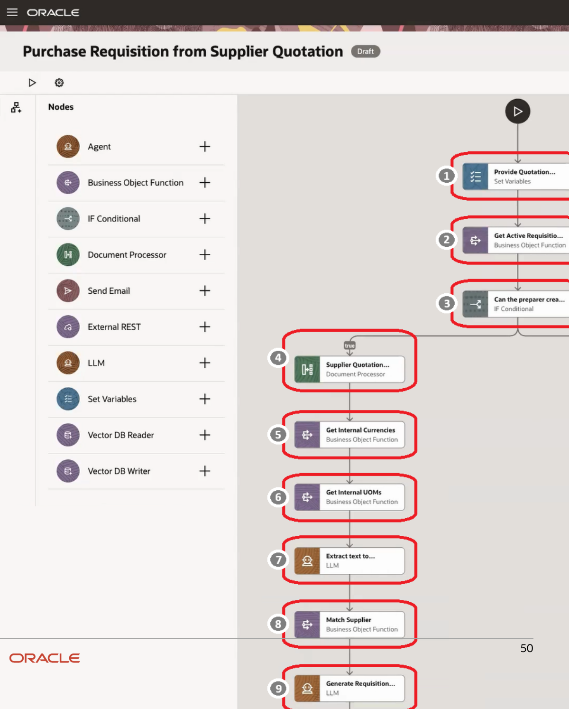

<a id="page-59"></a>

Oracle AI for Fusion Applications
How do I use AI Agent Studio?

Chapter 5
Create AI Agents

                     - If true, the workflow continues to the subsequent nodes.

                     - If false, the workflow indicates that a requisition wasn't created, sends a failur

requisition payload.

                                                   - If true, the workflow proceeds to the success confirmation node.

                                                   - If false, the workflow proceeds to the send failure email node.

|Callout<br>Number|Node Name|Node Type|
|---|---|---|
|1|Provide Quotation|Set variables|
|2|Get Active Requisition|Business Object Function|
|3|Can the preparer create a<br>requisition?|IF conditional|
|4|Supplier Quotation|Document processor|
|5|Get Internal Currencies|Business Object Function|
|6|Get Internal UOM|Business Object Function|
|7|Extract text to LLM|LLM|
|8|Match supplier|Business Object Function|
|9|Generate requisition<br>payload|LLM|
|10|Create purchase requisition|Business Object Function|
|11|Is requisition created?|IF conditional|
|12|Success confirmation|LLM|
|13|Send failure email|Send email|

Here are the steps to create your own workflow.

**1.** Go to **AI Agent Studio** .
**2.** From the **Agent Teams** tab, add an agent team and provide details for the new agent team.

**Details Tab**

|Field|Description|
|---|---|
|Family|Select the family to which this agent team belongs.|
|Product|Select the product within the family to which this agent team belongs.|

51

<a id="page-60"></a>

Oracle AI for Fusion Applications
How do I use AI Agent Studio?

|Field|Description|
|---|---|
|Type|Select**Workflow**.|

**LLM Tab**

|Field|Description|
|---|---|
|Provider|Select the LLM for your agent team.|

**Security Tab**

|Field|Description|
|---|---|
|Add|Select the roles which will have access to this agent team.|

**Triggers Tab**

Chapter 5
Create AI Agents

Create triggers to initiate the workflow. Triggers define the conditions or events that start the workflow and
determine when and why it begins.

|Field|Description|
|---|---|
|Type|Select the data type of the trigger.|

**Variables Tab**

Define workflow-level variables, making them accessible to all nodes within the workflow. Variables are ideal for
storing IDs, constants, or any values you need to share and use across different parts of the workflow.

|Field|Description|
|---|---|
|Type|Select the data type of the variable.|

**Chat Experience Tab**

You can allow users to upload attachments while interacting with agents. Users can upload up to five files, with
a total combined size limit of 50 MB. These file types are supported: PDF (tagged or scanned), TXT, DOCX,
XLSX, PNG, and JPEG.

|Field|Description|
|---|---|
|Enable file upload|Select this option to allow users to upload files from local storage.|

52

<a id="page-61"></a>

Oracle AI for Fusion Applications
How do I use AI Agent Studio?

Chapter 5
Create AI Agents

|Field|Description|
|---|---|
|Enable third party file upload|Select this option to allow users to upload files from connected cloud storage accounts.<br>To enable this functionality, add credentials for at least one provider by navigating to the<br>Credentials tab in AI Agent Studio and completing the Chat Experience setup.|

**Note:** To process attachments, make sure you add the runtime processing tool, **Runtime File Processor**, to
the relevant node.

**Output Tab**

Define the overall structure of the workflow’s output using JSON schema, to specify exactly what you will
receive when the workflow is completed. If no schema is specified, the output type defaults to that of the
individual node. When a schema is provided, the system validates the outputs against the schema and enables
auto-complete for those fields.

|Field|Description|
|---|---|
|Specification Mode|Select this mode to directly modify the JSON schema for the output.|
|Simple Mode|Use this mode to define output values and types. The corresponding JSON schema will be<br>generated automatically and displayed in the specification mode for you to edit.|

**Error Handling Tab**

Specify where to send an email when a workflow instance encounters a permanent error. You can also use
context expressions in these fields for additional clarity.
**3.** Click **Create** .

53

<a id="page-62"></a>

Oracle AI for Fusion Applications
How do I use AI Agent Studio?

Chapter 5
Create AI Agents

4. Add nodes to the workflow by hovering over the line between the start and end of the workflow. Click to
choose the type of node you want to add.

**Tips**

      - Connect nodes in sequence to control how inputs are received, processed, and forwarded throughout the
workflow.

      - You can insert new nodes before, after, or between existing nodes as needed.

      - For more information about Vector nodes, see _[Vector Write and Read Nodes](#page-62)_ .

      - Once created, you can’t rearrange the nodes. To change a node’s position, delete it and create it again in
the desired spot.
**5.** If needed, use to test the agent team. For any required fine-tuning, you can edit the agent team using  .
**6.** Publish the agent team.

Users can view the published agentic workflows from the AI Agents page. To open this page, add agent-explore
to the end of the URL for AI Agent Studio. For example, **`https://example.com/myApp/redwood/human-resources/`**
```
     ai-studio/agent-explore.

##### Vector Write and Read Nodes

```

To automate business processes effectively, your AI workflows require access to high-quality, well-structured, and
reusable knowledge. You can use Vector Write and Read nodes in AI Agent Studio to store knowledge as embeddings
and retrieve it intelligently with semantic search and metadata filters. By leveraging these nodes, you can design
workflows that capture, manage, and reuse critical business knowledge across processes, thereby improving accuracy,
scalability, and reliability in an enterprise environment.

Here's what you need to know to effectively use Vector Write and Read nodes in your workflow agents, along with some
best practices for organizing and managing enterprise knowledge for optimal retrieval.

Vector Write Node

Vector write nodes store high-value knowledge as embeddings for future semantic retrieval. These nodes are also
referred to as vector store nodes.

54

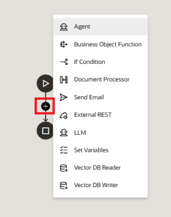

<a id="page-63"></a>

Oracle AI for Fusion Applications
How do I use AI Agent Studio?

Chapter 5
Create AI Agents

When you create a node, you can configure all values as expressions that resolve dynamically at runtime. Here's an
example of the node creation window. Each numbered field is described in detail in the following table.

55

<a id="page-64"></a>

Oracle AI for Fusion Applications
How do I use AI Agent Studio?

Chapter 5
Create AI Agents

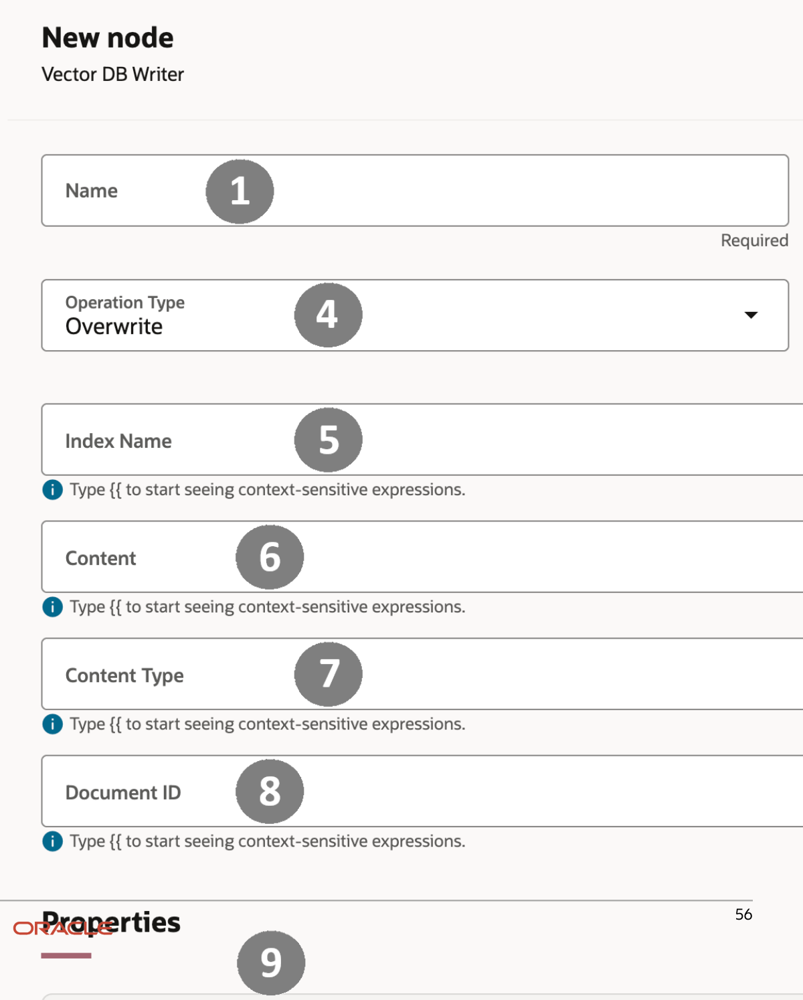

<a id="page-65"></a>

Oracle AI for Fusion Applications
How do I use AI Agent Studio?

Chapter 5
Create AI Agents

|Callout<br>Number|Field|Description|Example|
|---|---|---|---|
|1|Name|Design-time name for the node|Use descriptive names, like<br>**`WriteResolutionSummaryToVectorDB`**, so the<br>workflow is easy to understand.|
|2|Code|Programmatic identifier in the<br>workflow schema|This field is auto-generated but can be<br>changed to a user-defined one, such as<br>**`write_resolution_vector`**. Use lowercase and<br>underscores.|
|3|Error Handler|Fallback path on failure|Select an error branch or a dedicated handler node<br>to manage failures cleanly.|
|4|Operation Type|Method of how the document is<br>written to the index|Use**`INSERT`**for new entries,**`OVERWRITE`**to replace<br>content,**`UPSERT`**to safely update or create, or<br>**`DELETE`**to remove entries.|
|5|Index Name|Name of the vector index to write to|Choose an existing index or specify a new<br>one, such as**`support_ticket_summaries`** or<br>**`product_docs_index`**.|
|6|Content|Textual data to embed|Summarize this in a clean and structured manner.<br>Avoid raw logs. Instead, use LLM-generated<br>summaries, extracted facts, or curated knowledge.|
|7|Content Type|Type of content being indexed or<br>embedded|Typical values include**`json`**or**`text`**.|
|8|Document ID|Unique identifier for this record|Use stable identifiers, such as**`ticket_1123`** or<br>**`customer_450_profile`**.|
|9|Properties|Additional optional metadata key-<br>values|**`{objectId:"a12345", region:“NA”,`**<br>**`severity:“High”}`**|

Best Practices for Building Vector Write Nodes

A vector store works best when you write clear, meaningful, metadata-rich knowledge while avoiding noise, duplication,
and topic drift.

|Best Practice|Description|
|---|---|
|Store only public,<br>reusable knowledge|Exclude sensitive, permission-controlled, or private information, for example, personally<br>identifiable information (PII), credentials, confidential documents, or any information<br>requiring permission checks.|
|Focus on durable, high-<br>value content|Store information that will have long-term value for future workflows, such as case<br>resolutions, structured summaries, or validated insights. Avoid writing noisy, one-off, or<br>ephemeral content, like raw chat logs or temporary instructions.|
|Clean and normalize<br>before writing|Always standardize content, summarize documents, deduplicate overlaps, remove<br>irrelevant details, and attach key metadata.|

57

<a id="page-66"></a>

Oracle AI for Fusion Applications
How do I use AI Agent Studio?

Chapter 5
Create AI Agents

|Best Practice|Description|
|---|---|
|Keep data up to date|Vector writes must reflect the latest truth. Stale entries decrease accuracy and lead to<br>incorrect answers.<br> <br>• Set auto-refresh triggers to update vectors whenever business objects change (for example, case closures,<br>policy updates, PO resolutions).<br>• Use OVERWRITE or UPSERT to keep summaries up to date.<br>• Delete outdated or unused entries to prevent stale data from accumulating.<br>• Maintain freshness so workflows rely on accurate, up-to-date knowledge.<br>|
|Follow smart update<br>practices|Update vectors in a controlled and intentional manner. Don't create new entries for each<br>update, or store conflicting or outdated data.<br> <br>• Avoid creating new entries for every update. Refine existing data instead of duplicating.<br>• Use UPSERT to update and improve existing summaries.<br>• Use OVERWRITE for significant changes or new, higher-quality content.<br>• Prune redundant or conflicting entries to keep the vector store clean.<br>• Establish clear versioning strategies for policies, product versions, and configuration changes to prevent<br>fragmentation.<br>|
|Always include rich<br>metadata|Tag with business object IDs, product numbers, version information, and other searchable<br>attributes. Use a consistent metadata schema across agents and indexes.|
|Prevent data pollution|Check for existing knowledge to avoid duplicates and inconsistent tags. Regularly remove<br>low-value content.|
|Exclude business object<br>data|Duplicating this data in vector memory creates noise, redundancy, and version drift.|

Vector Read Node

Vector read nodes retrieve the most relevant knowledge using semantic similarity and metadata filters.

Here's an overview of what the node creation window looks like. When creating a node, all values can be configured as
expressions that will be resolved at runtime.

58

<a id="page-67"></a>

Oracle AI for Fusion Applications
How do I use AI Agent Studio?

Chapter 5
Create AI Agents

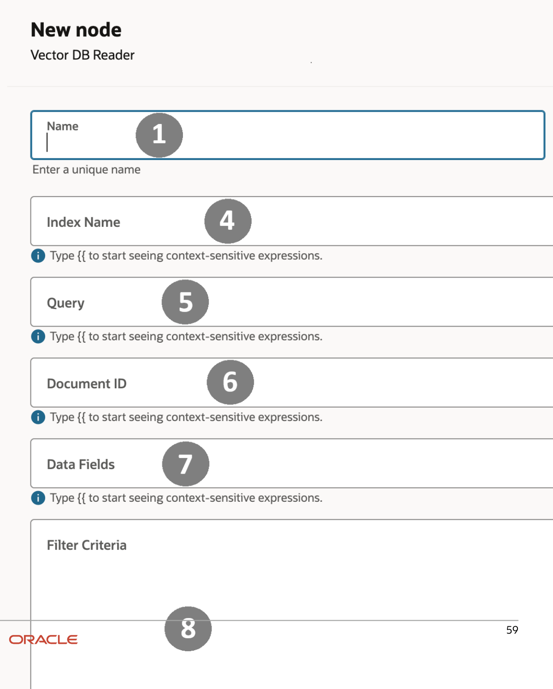

<a id="page-68"></a>

Oracle AI for Fusion Applications
How do I use AI Agent Studio?

Chapter 5
Create AI Agents

|Callout<br>Number|Field|Description|Example|
|---|---|---|---|
|1|Name|Name of the node|Use clear names like<br>**`RetrieveTicketContextFromVectorDB`** to keep the<br>workflow readable.|
|2|Code|Internal programmatic identifier|This field is auto-generated but can<br>be changed to a user-defined one, like<br>**`read_ticket_context_vector`**.|
|3|Error Handler|Defines what occurs on failure|Route to an error handler or fallback logic to<br>avoid empty or invalid agent responses.|
|4|Index Name|Vector index to search|Choose the same index used by the writer,<br>such as**`support_ticket_summaries`** or<br>**`employee_profile_index`**.|
|5|Query|Natural language search query|Avoid vague queries and ask for intent-specific<br>info, such as, “What troubleshooting steps were<br>taken?”|
|6|Document ID|Unique identifier for this record.|Specify this when you want details tied to a<br>known record, such as**`ticket_12345_summary`**.|
|7|Data Fields|Metadata fields to return|Specify an array of strings that will be used in the<br>filter.|
|8|Filter Criteria|Logical filters applied before ranking|Specify this field to enable high precision and to<br>constrain results from a retrieval, such as**`product`**<br>**`= Payroll`**, **`region = US`**, or**`severity >= High`**.|
|9|Maximum Results|Maximum number of ranked results<br>returned|Specify an integer value for the max number of<br>results to be displayed.|

Best Practices for Building Vector Read Nodes

A vector read node works best when you write clear, specific queries that leverage metadata filters to ensure
semantically accurate responses, while preventing topic drift and hallucinations.

|Best Practice|Description|
|---|---|
|Write clear, intent-driven<br>queries<br>|Ensure queries are specific and aligned with the exact workflow or agent task. For example,<br>use precise prompts like "What resolved similar issues?" instead of vague ones like "Help<br>me with this."|
|Use metadata filters for<br>precision<br>|Apply filters (for example, entity type, business object ID, and product number) to target<br>only relevant content.<br>|
|Validate retrieved results<br>before using them<br>|Check metadata and context before trusting or using results in workflows. This validation<br>prevents incorrect answers, silent workflow failures, and LLM hallucinations grounded in<br>bad evidence.<br>|

60

<a id="page-69"></a>

Oracle AI for Fusion Applications
How do I use AI Agent Studio?

Chapter 5
Create AI Agents

|Best Practice|Description|
|---|---|
|Set an appropriate<br>**`maxResults`** value<br>|Set the**`maxResults`**field to return three to five, or more results. Don't depend on a single<br>query result.<br>|
|Add graceful fallback<br>logic<br>|Implement backup steps, such as business objects or API lookups, to handle cases where<br>queries return no results.<br>|
|Avoid broad or irrelevant<br>retrieval<br>|Scope queries to just what’s needed. Skip irrelevant or noisy indexes to boost performance<br>and accuracy of retrieved results.<br>|

61

<a id="page-70"></a>

Oracle AI for Fusion Applications
How do I use AI Agent Studio?

Chapter 5
Create AI Agents

62

<a id="page-71"></a>

Oracle AI for Fusion Applications
How do I use AI Agent Studio?

## **6 Monitor and Evaluate AI Agents**

#### Monitor and Evaluate AI Agents

Chapter 6
Monitor and Evaluate AI Agents

Monitor and gain insights into how your AI agents are performing, and also evaluate the agents for accuracy. You
can also track the interactions with your agents, understand real-world usage patterns, identify common errors, and
measure overall performance.

    - Monitoring: Monitoring tracks performance and provides insight on how your agents behave in production.
Monitor agents to ensure that your quality bars for response time and token counts are maintained over time.
You can also see any errors logged here.

    - Evaluation: Evaluate agents before you deploy them, to ensure that they're ready for production. Test your
agents for response correctness, response time, and token usage to meet your quality standards. You can also
check the quality of answers generated through the document tool to assess how effectively agents utilize the
retrieved context from the retrieval-augmented generation (RAG) metrics. After making any changes to your
agent, or after a model update, rerun evaluations to confirm that your agent continues to perform as expected.
This proactive approach helps you maintain high-quality experiences for your users.

This table summarizes some key metrics, their descriptions, and their availability for monitoring or evaluation.

|Metric|Description|Available to Evaluate|Available to Monitor|
|---|---|---|---|
|Error Rate|Percentage of user sessions that<br>ended in an error.|Yes|Yes|
|Error Count|Total number of errors recorded.|Yes|Yes|
|Session Count|Total number of conversations<br>initiated with agents.|Yes|Yes|
|P99 Latency|The maximum wait time in<br>milliseconds for 99% of users,<br> revealing any areas where you<br>should review and optimize the<br>prompts or structure of the agent.|Yes|Yes|
|P50 Latency|The maximum wait time in<br>milliseconds for 50% of users,<br> helping identify performance<br>issues.<br> <br>You can view this metric in the<br>details of the monitoring or<br>evaluation results.<br>|Yes|Yes|

63

<a id="page-72"></a>

Oracle AI for Fusion Applications
How do I use AI Agent Studio?

Chapter 6
Monitor and Evaluate AI Agents

|Metric|Description|Available to Evaluate|Available to Monitor|
|---|---|---|---|
|Total Tokens|Cumulative number of tokens used<br>by all agents.|Yes|Yes|
|Input Token Count|Total tokens sent to the LLM for<br>requests. This includes system<br>prompts, user messages, retrieved<br>or context data, chat history, and<br>tool or function definitions.|No|Yes|
|Output Token Count|Total tokens generated by the LLM<br>for requests sent to it.|Yes|Yes|
|Median Correctness|The 50th percentile of correctness<br>scores across evaluation runs.<br>Each score (0–1) is computed by<br>comparing the agent’s answer to<br>the reference answer provided in<br>the evaluation set.|Yes|No|
|Session Count|The number of unique<br>conversational sessions between a<br>user and an AI agent. One session<br>can include multiple messages or<br>evaluation runs.|Yes|Yes|
|Groundedness|Alignment of the generated answer<br>with the retrieved source content,<br> indicating how faithfully the<br>response reflects the supporting<br>information.|Yes|No|
|Answer Relevance|Degree to which the answer<br>directly addresses the user’s<br>question, measuring how fully and<br>precisely the content covers the<br>required subject matter.|Yes|No|
|Context Relevance|Quality and appropriateness of the<br>retrieved information, assessing<br>whether it meets the necessary<br>standards to be considered reliable<br>evidence.|Yes|No|

###### Prerequisites

Aggregate the metrics that are displayed on the Monitoring and Evaluation tab in AI Agent Studio.

**1.** Go to **Navigator**    - **Tools**    - **Scheduled Processes** .
**2.** In Scheduled Processes, click **Schedule New Process** .
**3.** Leave the type as **Job** .

64

<a id="page-73"></a>

Oracle AI for Fusion Applications
How do I use AI Agent Studio?

**4.** Search for and select **Aggregate AI Agent Usage and Metrics** .
**5.** Run the **Aggregate AI Agent Usage and Metrics** scheduled process.

Chapter 6
Monitor and Evaluate AI Agents

You can schedule this process to run on a recurring basis, for example, once a day.

The process aggregates the metrics that are displayed in the Monitoring and Evaluation tab of AI Agent Studio.

#### Monitor Agents

**1.** Go to **Navigator**    - **Tools**    - **AI Agent Studio** .
**2.** From the Monitoring and Evaluation tab, go to the Monitoring tab.

      - The Monitoring subtab displays aggregated metrics of all the agent runs over the selected time frame.

      - All supervisor agent runs are monitored, including agents in draft status.

**3.** Select the agent to view additional details.

Each row represents a single session and displays the number of turns (back-and-forth messages), the
session’s completion status (successful or error), and the number of tokens used.
**4.** Select any session in the list to open the detailed trace view. This view displays a step-by-step timeline of the
entire conversation, showing exactly which tools were called, the duration of each step, and the metrics for each
step.

#### Evaluate Agents

65

<a id="page-74"></a>

Oracle AI for Fusion Applications
How do I use AI Agent Studio?

Chapter 6
Monitor and Evaluate AI Agents

Use evaluation sets to assess your agents’ performance. An evaluation set contains one or more test questions, the
expected agent responses, and the metrics to be measured. Evaluation sets are specific to each agent, and an agent can
have multiple evaluation sets.

**1.** Create an evaluation set for an agent.

**a.** Go to **AI Agent Studio** .
**b.** Select the Monitoring and Evaluation tab.

All evaluations run on the agents are displayed in the Evaluation tab.
c. To create an evaluation set, click **Manage Evaluations** and select .
**d.** Enter a name, code, and description for the evaluation set, and select the agent team to be evaluated.
**e.** Choose the run mode.

**Sequential** : Runs the questions in the exact order you define them. Use this if one question depends on
the context of the previous one.

**Random** : Runs the questions in a random order.
**f.** Select **Enable document tool evaluation** if you want to view RAG metrics in the evaluation report.
**g.** From the Questions tab, add common questions that users are likely to ask the agent and the answers
you would like the agent to deliver. Ensure both the questions and answers are concise, user-friendly, and
reflect best practices.

You can either add your questions and the expected answers individually, or upload a CSV file with the
questions in the first column and the expected answers in the second column.
**h.** From the **Metrics** tab, edit each metric to set the pass and fail criteria. For example, to indicate that the
test fails if the correctness score is less than 0.7, choose **<** as the threshold condition and enter 0.7 as the
threshold value.
**i.** Select **Create** to save the evaluation set.
**2.** Run the evaluation set.

**a.** On the Manage Evaluations page, select the **Initiate Evaluation Run** action for your evaluation set.
**b.** Choose the version of the agent team to evaluate and run the evaluation.
**3.** Analyze the results.

**a.** Click the evaluation set to view the Evaluation Runs page.
**b.** Select the evaluation run and select the **View Run Results** action.

|Tab|Information Displayed|
|---|---|
|Response performance|**-**<br>Comparison of the expected response versus the actual response from the agent for<br>each question, along with the metrics for each question in the evaluation.<br>**-**<br>Trace provides information about the detailed timeline for each question in the<br>evaluation.|
|Correctness|Detailed breakdown of the correctness score. The LLM provides an initial score and<br>feedback, and you can add your own feedback for record keeping in the**Correctness**<br>**Score by Human** column.|

66

<a id="page-75"></a>

Oracle AI for Fusion Applications
How do I use AI Agent Studio?

#### Compare Evaluation Runs

Chapter 6
Monitor and Evaluate AI Agents

You can see a side-by-side comparison of two different runs of the same evaluation, and easily spot regressions or
improvements in latency, correctness, and token usage. Doing so, you can understand how an agent's performance
changes over time, especially after you've made modifications.

**1.** From the Evaluation tab, select the evaluation.
**2.** Select any two runs and click **Compare** .

      - The Summary tab displays a high-level overview of the performance differences between the runs.

      - The Details tab provides a granular, question-by-question breakdown of the runs. For each question in
the evaluation set, you can directly compare the actual response from Run 1 against the actual response
from Run 2. You can also compare the specific latency, tokens used, and trace links for each question,
making it easy to pinpoint exactly where and why performance or accuracy has changed.

67

<a id="page-76"></a>

Oracle AI for Fusion Applications
How do I use AI Agent Studio?

Chapter 6
Monitor and Evaluate AI Agents

68

<a id="page-77"></a>

Oracle AI for Fusion Applications
How do I use AI Agent Studio?

Chapter 7
Migrate RAG Agents to AI Agent Studio

## **7 Migrate RAG Agents to AI Agent Studio**

#### Migrate Document Tools of RAG Agents

If you've created any RAG agents in Oracle Fusion Cloud Applications previously, we recommend that you replace your
existing agent with an agent you create in AI Agent Studio.

You can migrate the Document tool you created for your existing agent to AI Agent Studio.

**1.** Go to the **Configure RAG Agents** work area.

**Tip:** You can use global search to get to the work area.

2. From the Tools tab, click to migrate your tool.
**3.** Enter a unique tool name and code. That will help you easily find your migrated tool in AI Agent Studio.

After migrating your tool, create a new agent in AI Agent Studio using an appropriate template, add your migrated tool,
and publish your agent. After testing and verifying your new agent, you can delete the original agent in the **Configure**
**RAG Agents** work area.

69

<a id="page-78"></a>

Oracle AI for Fusion Applications
How do I use AI Agent Studio?

Chapter 7
Migrate RAG Agents to AI Agent Studio

70

<a id="page-79"></a>

Oracle AI for Fusion Applications
How do I use AI Agent Studio?

## **8 Promote Published Agents**

Chapter 8
Promote Published Agents

#### Migrate AI Agents from One Instance to Another

You can migrate an individual agent team from one environment to another using the import and export options
available in AI Agent Studio. For example, you can export from the test or staging environment and import into the
production environment.

After importing the agent team, you must publish it in the new environment to make it available for use. Also, if any of
your agents use the following tools, make sure you complete the corresponding post-import tasks for each tool:

    - Document tool: Upload and republish the document to ensure its content is correctly processed in the new
environment.

    - Email tool: Reconfigure the email tool to make sure necessary alerts are generated properly in the new
environment.

    - External REST tool: Reconfigure authentication settings for external REST API tools.

To migrate an agent team:

**1.** From the source environment, go to **AI Agent Studio** .
2. From the Agent Teams tab, locate the agent team you want to export and click the icon.
**3.** Enter the export details and click **Export** to download the JSON file to your local system.
**4.** From the target environment, go to **AI Agent Studio** and select the Agents tab.
**5.** Click **Import** and upload the previously downloaded JSON file.
**6.** Use the **Draft** button to edit the imported agent team.
**7.** Publish the agent team.

71

<a id="page-80"></a>

Oracle AI for Fusion Applications
How do I use AI Agent Studio?

Chapter 8
Promote Published Agents

72

<a id="page-81"></a>

Oracle AI for Fusion Applications
How do I use AI Agent Studio?

Chapter 9
Create Channels in AI Agent Studio

## **9 Create Channels in AI Agent Studio**

#### Create Microsoft Teams Channel for AI Agent Studio

You can integrate Microsoft Teams with AI Agent Studio, and enable users to access Oracle AI agents from Microsoft
Teams. The integration preserves user identity and data security across Oracle Fusion Cloud Applications and Microsoft
accounts. After integration, users can select **Ask Oracle** app in Microsoft Teams and interact with the AI agents available
to them.

Integration with Microsoft Teams involves configuring several Microsoft 365 services, including Microsoft Entra
(Azure Active Directory), Microsoft Bot Framework, and the Teams App Manifest. These components are closely
interdependent and must be configured correctly across environments and tenants. Proper coordination and version
management are essential for identity flows, manifest packaging, channel registrations, permission scoping, and
endpoint exposure.

Here are the steps to set up Ask Oracle in Microsoft Teams:

**1.** Register Azure bot in Microsoft Entra (Azure Active Directory). Ensure to save the bot ID, password and tenant
ID after registration.
**2.** Create a manifest file for Microsoft Teams in AI Agent Studio, and download it.
**3.** Upload the manifest file downloaded from AI Agent Studio in Microsoft Teams.

###### Register Azure Bot in Microsoft Entra

**1.** As an Azure/Exchange administrator, sign in to the _[Microsoft Azure portal](https://portal.azure.com/)_ .
**2.** Click **Create a resource** and search for **Azure Bot** .
**3.** Create the bot by adding these details:

      - Enter a unique bot handle.

      - Choose your active subscription.

      - Select an existing resource group or create one. For **Type of App**, select **Single Tenant** .

      - Select **Create new Microsoft App ID** as **Creation Type** .

**4.** Click next and create the bot.
**5.** After deployment is complete, click **Go to resource** .
**6.** Enter the URL of the bot service in **Messaging endpoint** . The URL will be of this pattern:

```
     https://<pod name>/api/fusion-ai/orchestrator/collabTools/v1/teams-message

```

Replace <pod name> with the base URL of your Oracle application environment.

**Note:** Make a note of the App ID and Tenant ID because you'll need them when creating the manifest file in
AI Agent Studio.

**7.** Generate a client secret:

**a.** Click **Manage Password** next to **Microsoft App ID** and create a new client secret.
**b.** Provide a description, for example, Oracle Agents Secret, and select a desired expiry date.

73

<a id="page-82"></a>

Oracle AI for Fusion Applications
How do I use AI Agent Studio?

Chapter 9
Create Channels in AI Agent Studio

**Note:** Make a note of the client secret because you'll need it when creating the manifest file in AI Agent
Studio.

**8.** Configure Application Permissions:

**a.** From the left panel, open **API Permissions** .
**b.** Go to **Add Permission**       - **Microsoft Graph**       - **Application Permissions** .

**c.** In the **User** folder, search for **User.ReadBasic.All** and add it.
**d.** Click **Grant admin consent** for the added permission.
**9.** Configure Delegate Permissions:

**a.** From the left panel, open **API Permissions** .
**b.** Go to **Add Permission**       - **Microsoft Graph**       - **Delegate Permissions** .

**c.** In the **User** folder, search for **User.ReadBasic.All** and add it.
**d.** Click **Grant admin consent** for the added permission.
**10.** Enable Microsoft Teams Channel:

**a.** Go back to your bot resource, and open **Channels** from the left panel.
**b.** Select the **Microsoft Teams** channel, agree to the terms and conditions, and click **Apply** .

###### Create Manifest File in AI Agent Studio

Prerequisite: Make sure that your role has the necessary permission groups. For more information, see Assign
Permission Groups to Use Channels in Credentials in _Access Requirements for AI Agent Studio_ .

**1.** In **AI Agent Studio**, go to the Credentials tab, and then open the Channels tab.
**2.** Configure **Microsoft Teams** .
**3.** Enter details for the channel manifest file.

      - Short Manifest Name: Enter the short name for the app as displayed in Microsoft Teams. The default
value is **Ask Oracle** .

      - Full Manifest Name: Enter the full name for the app as displayed in Microsoft Teams. For example, Ask
Oracle Fusion Agent.

      - Manifest Code: Enter a unique ID to be used in AI Agent Studio (not part of the Microsoft Teams schema).
For example, b3e4a289-7cbb-43d3-9a4c-d52bc874e830

      - Version: Select the manifest schema version.

      - Manifest Schema Version: Select the Microsoft schema version that's to be used for the manifest file.

      - Oracle Instance URL: Enter the URL for the Oracle tenant for Fusion Applications.

Format is
```
        https://<fully qualified pod name>:<optional port>

Create separate manifests for each tenant.

- Bot ID or App ID: Enter the App ID that was generated during the Azure bot setup.

- Tenant: Enter the Tenant ID that was generated during Azure bot setup.

- Secret: Enter the client secret that was generated during the Azure bot setup.

- Advanced Settings: List of valid domains or websites the bot can access or redirect to. Include all API or
identity-related endpoints.

**Note:** You must add token.botframework.com with the fully qualified pod name.

**4.** Create the manifest file.

74

<a id="page-83"></a>

Oracle AI for Fusion Applications
How do I use AI Agent Studio?

**5.** Select **Edit** and download the manifest file, to be used in Microsoft Teams.

###### Upload Bot Artifacts in Microsoft Teams Console

Chapter 9
Create Channels in AI Agent Studio

**1.** As an administrator, go to _[Microsoft Teams Admin Center](https://admin.teams.microsoft.com/)_ .
**2.** Open **Manage Apps** and select **Upload new app** from the **Actions** menu.
**3.** Upload the manifest file downloaded from AI Agent Studio.
**4.** Publish the app. Your app now appears in the list of available apps.
**5.** In **Manage Apps**, go to **Setup Policies**   - **Org Wide Policy** and add the app you published.

Your app is now available to all users included in Org Wide Policy.

#### Create Slack Channel for AI Agent Studio

You can integrate Slack with AI Agent Studio, and enable users to access Oracle AI agents from Slack. After integration,
users in the workspace can select the **Ask Oracle** app in Slack and interact with the AI agents available to them.

The setup process involves these high-level steps:

**1.** Create the Slack channel manifest in AI Agent Studio.
**2.** Create the Ask Oracle app in _[api.slack.com/apps](https://[api.slack.com/apps](https://[api.slack.com/apps](https://[api.slack.com/apps](https://api.slack.com/apps))))_ and add the manifest file.
**3.** Update the manifest file created in AI Agent Studio and add the credentials to the Bot configuration section.
**4.** Add the Ask Oracle app in Slack.

###### Create Manifest File in AI Agent Studio

Before you start, make sure your role has the necessary permission groups. For more information, see **Assign**
**Permission Groups to Use Channels** in _Access Requirements for AI Agent Studio_ .

**1.** In AI Agent Studio, go to the Credentials tab, and then open the Channels tab.
**2.** Configure Slack.
**3.** Enter details for the channel manifest file.

      - Manifest Short Name: Enter the short name for the app. The default value is Ask Oracle.

      - Manifest Full Name: Enter the full name for the app. For example, Ask Oracle Fusion Agent.

      - Version: Enter the manifest file version.

      - Manifest Schema Version: Select the schema version that's to be used for the manifest file.

**4.** Create the manifest file.
**5.** Copy the manifest details from the Manifest.json section. You'll need this information when creating the app on
_[api.slack.com/apps](https://api.slack.com/apps)_ .

###### Create Ask Oracle App in Slack

**1.** Go to _[api.slack.com/apps](https://api.slack.com/apps)_ and select **Create New App** .
**2.** Select **From a manifest**, choose the workspace, and click **Next** .
**3.** In the JSON tab, paste the manifest details copied from the manifest file created in AI Agent Studio.

75

<a id="page-84"></a>

Oracle AI for Fusion Applications
How do I use AI Agent Studio?

**4.** Click **Next** and create the app.
**5.** Select the app you created and go to **Settings**   - **Basic Information** .
**6.** Note down these credentials for later use:

      - App ID

      - Client ID

      - Client Secret

      - Signing Secret

**7.** Go to **Settings**    - **Install App** and install the app.
**8.** Make a note of the **Bot User OAuth Token** value.

###### Update Manifest File in AI Agent Studio

Chapter 9
Create Channels in AI Agent Studio

**1.** In AI Agent Studio, go to the Credentials tab, and then open the Channels tab.
**2.** Edit the Slack manifest file.
**3.** In the Bot configuration section, enter the credentials you saved from the Slack application setup.

      - Bot ID or App ID

      - Client ID

      - Secret

      - Token

      - Signing Secret

**4.** Update the manifest file.

###### Add the Ask Oracle App in Slack

**1.** Open the Slack application and select **Add app** .
**2.** Add Ask Oracle.

Users in the workspace can now interact with the Oracle AI agents they've access to.

76

<a id="page-85"></a>

Oracle AI for Fusion Applications
How do I use AI Agent Studio?

Chapter 10
Allow External Access to Fusion Applications Agents

## **10 Allow External Access to Fusion**
### **Applications Agents**

#### Enable Applications to Access Fusion Applications Agents

You can access the agents of Oracle Fusion Cloud Applications from other Oracle applications and from external
applications, using the `/invokeAsync` API.

###### Access from Other Oracle Applications

To use `/invokeAsync` API, you must authenticate through Oracle Cloud Infrastructure Identity and Access
Management (OCI IAM) using an OAuth 2.0 bearer token. For agent operations to function, integration must be
bidirectional. Both systems must securely access each other’s services.

As an administrator, you create the confidential application in Fusion Applications IAM, representing the other Oracle
application service. Then create a matching confidential application in the other application service, representing the AI
Agent Studio's service. These two applications form the trusted link for the two-way communication.

**Set Up Two-Way Trust Between Applications**

**1.** Create a confidential application in Fusion Applications IAM:

This application acts as a representation of the external Oracle application in Fusion Applications IAM. After
creating the confidential application, enable access to the AI Agent Studio service so the application can call the
`/invokeAsync` API exposed by this service.

      - Identify the identity domain (authorization server) where you'll create your confidential application.

      - Specify OAuth grant types. For example, a 2-legged OAuth.

      - Define the access scope.

      - Generate the access token and use it to make REST API calls.

For more information, see _[Configure OAuth Using the Fusion Applications Identity Domain](https://docs.oracle.com/en/cloud/saas/applications-common/26a/farca/configure_oauth.html)_ .
**2.** Create a confidential application in the external Oracle application's IAM:

Similar to the previous confidential application you created, create another confidential application that acts as
a representation of the Fusion Application service in the external Oracle application’s IAM. After creating the
confidential application, configure it to allow AI Agent Studio to call the appropriate service endpoints.

For more information, see _[Configure OAuth Using the Fusion Applications Identity Domain](https://docs.oracle.com/en/cloud/saas/applications-common/26a/farca/configure_oauth.html)_ .
**3.** Register the confidential application created in the external Oracle application's IAM (from step 2) in AI Agent
Studio:

**a.** Go to **AI Agent Studio** and open the Credentials tab.
**b.** Go to the Data Source Applications tab and add the details of the external confidential application.

**-** Base URL: Enter the base URL of the external API

77

<a id="page-86"></a>

Oracle AI for Fusion Applications
How do I use AI Agent Studio?

Chapter 10
Allow External Access to Fusion Applications Agents

**-** IDCS URL: Enter the URL of the Fusion Applications IAM, to enable AI Agent Studio to get the
OAuth token

**-** Scope: Specify what access needs to be given whenever that OAuth token is retrieved.

**-** Public and Private keys: Enter the keys for signing authentication requests. Used by IDCS to verify
that the request is from a trusted and authorized source.
**4.** Create a business object to access the external Oracle application:

**a.** In **AI Agent Studio**, open the Business Object tab.
**b.** Add a new business object with the **Resource Type** as **Other Data Source Application** .

**c.** From the **Oracle Data Source Application** list, select the data source application that you've registered in
step 3.

**Access Flow During Runtime**

At runtime, the external Oracle application obtains an access token from Fusion Applications using the configured
credentials. The application then uses this token to call the `/invokeAsync` API in AI Agent Studio, enabling access to
the agent team.

This illustration shows the interactions between Warehouse Management System (WMS), which is an Oracle application
outside Fusion Applications, Fusion Applications IAM, AI Agent Studio, and WMS IAM.

78

<a id="page-87"></a>

Oracle AI for Fusion Applications
How do I use AI Agent Studio?

Chapter 10
Allow External Access to Fusion Applications Agents

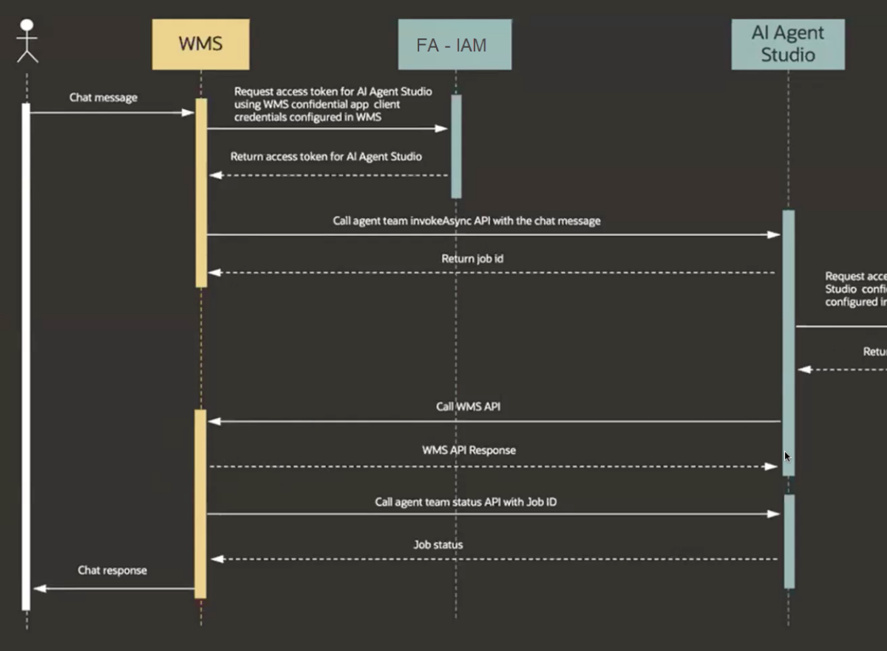

- The user interacts with the WMS application and sends a chat message.

- WMS requests an access token from Fusion Applications IAM using its configured credentials.

- WMS calls the `/invokeAsync` API in AI Agent Studio, passing the user’s chat message and access token.

- AI Agent Studio returns a Job ID to WMS, which WMS uses to track progress and get the response.

- To call WMS API, AI Agent Studio requests an access token from WMS IAM.

- AI Agent Studio calls the WMS API using the access token.

- WMS returns the API response and requests for the job status.

- AI Agent Studio returns the job status.

- Final chat response is processed and delivered to the user.

79

<a id="page-88"></a>

Oracle AI for Fusion Applications
How do I use AI Agent Studio?

###### Access from External Applications

Chapter 10
Allow External Access to Fusion Applications Agents

Use `/invokeAsync` API to access the agents of Fusion Applications. For more information, see _[Agent Team REST](https://docs.oracle.com/en/cloud/saas/applications-common/26a/farca/api-fusion-ai-agent-team.html)_
_[Endpoints](https://docs.oracle.com/en/cloud/saas/applications-common/26a/farca/api-fusion-ai-agent-team.html)_ .

80

<a id="page-89"></a>

Oracle AI for Fusion Applications
How do I use AI Agent Studio?

## **11 AI Agent Studio FAQs**

Chapter 11
AI Agent Studio FAQs

#### When do I need a Custom AI Agent Subscription for AI Agent Studio?

AI Agent Studio is included with your Oracle Fusion SaaS Cloud subscription and comes with a variety of ready-to-use
agent templates at no additional cost. You may use and make minor changes to these templates, such as uploading
documents, adjusting display fields, or editing prompts, without requiring a Custom AI Agent subscription. However, a
subscription is required if you want to create entirely new agents, significantly modify existing templates (for example,
by adding new integrations, actions, or changing the agent’s overall purpose), use third-party or marketplace agents,
or select large language models (LLMs) that aren't provided by Oracle. Additional fees may also apply if your usage of
premium LLMs exceeds your default token allocation. For more information, see _[Fusion Custom AI Agents - Pricing FAQ](https://support.oracle.com/support/?documentId=KB864473)_
_[(KB864473)](https://support.oracle.com/support/?documentId=KB864473)_ .

#### Which large language models (LLMs) are currently used or supported for AI agents?

Oracle Fusion Cloud Applications support several LLMs from providers such as, Cohere, Meta, and OpenAI, for powering
AI features including content authoring, summarization, and interactive Q&A. For the most current list of supported
models, see _[What Large Language Models (LLM) are in use or supported by Fusion SaaS Applications? (KB796229)](https://support.oracle.com/support/?documentId=KB796229)_ .

#### Can I use any agent in my agent team or workflow?

No, you can't use just any agent in your agent team or workflow. You can use predefined agents and reuse agents
created from the Agents tab in AI Agent Studio in other agent teams and workflows. However, if you create an agent
directly within an agent team or workflow, that agent can't be reused and will only be available in the specific agent
team or workflow where it was created.

#### When should I use a single-agent flow vs a multiagent process?

    - Use a single-agent process for straightforward business requirements, such as retrieving answers from a single
policy document.

81

<a id="page-90"></a>

Oracle AI for Fusion Applications
How do I use AI Agent Studio?

Chapter 11
AI Agent Studio FAQs

    - Opt for a multiagent process when dealing with more complex scenarios. For example, when multiple
documents need to be parsed, or when the answers vary based on the user asking the question. In these cases,
multiple agents are used, and the user’s question is directed to the appropriate worker agent for processing.

#### Can I edit a preconfigured agent team?

You can't directly modify the components in a preconfigured agent team template. However, you can create copies of
individual components (such as topics), edit them, and then add the edited versions to your agent team after removing
the original components. For example, to edit a topic that's part of a preconfigured agent team template you're using,
do these steps.

**1.** Go to **AI Agent Studio**, and select the preconfigured agent team template you need, either using **Copy**
**Template** or **Use Template** .
**2.** From the selected template, remove the topic you want to edit.
**3.** Go to the Topics tab, and search for the topic you removed.
4. Click and create a copy of this topic.
**5.** Edit the copied topic as needed and add it back to your agent team.
**6.** Save and publish your agent team.

#### How do I make agents respond faster?

AI agent response time is directly linked to the combined length of input and output text, measured in tokens for
each transaction. For example, 100 tokens is roughly 75 words, though this ratio varies by model, writing style, and
language. By being deliberate with your instructions, you ensure that your agents reason clearly and avoid unnecessary
processing.

Here are some recommendations to help your agents respond faster.

    - Edit summarization prompts to include only essential instructions relevant to your specific use case. The
default prompts for supervisor and workflow agents are broadly written to cover many scenarios, so remove
any general or redundant sections to streamline processing and improve response speed.

    - Minimize the use of input and output tokens with concise prompts. Use retrieval-augmented generation (RAG)
instead of overloading the context window, and set specific output length limits.

    - Specify response length to avoid overly verbose answers.

    - Use smaller, specialized agents that work in parallel and cache static instructions.

    - Include only relevant information. Remove unnecessary details from context and documents to streamline
processing.

    - Consider a multi-agent approach, where specialized agents handle distinct tasks, such as research, coding, or
Q&A, instead of loading all information into a single prompt.

By carefully selecting relevant context and breaking complex tasks into smaller, focused agents, you can improve both
the speed and efficiency of your AI agents.

82

<a id="page-91"></a>

Oracle AI for Fusion Applications
How do I use AI Agent Studio?

Chapter 11
AI Agent Studio FAQs

#### How do I track the usage of AI Agents created in AI Agent Studio?

You can use the Monitoring and Evaluation tab within the AI Agent Studio to track real-time interactions, analyze usage
patterns, and identify errors to improve agent accuracy and performance. For more information, see _Monitor and_
_Evaluate AI Agents_ .

#### How can I best reduce the risk of my agent showing hallucinations?

Large language models (LLMs) can unintentionally introduce extra details when they lack sufficient information.

To mitigate this issue, consider these strategies:

    - Supply the necessary knowledge: Integrate relevant sources such as business objects, REST APIs, or RAG
documents, ensuring the LLM has access to accurate and up-to-date information.

    - Use explicit prompt instructions: Clearly instruct the LLM not to add or infer information beyond what's
provided, reducing the risk of embellishment or fabrication.

#### How do I hide or restrict access to AI Agent Studio for specific users?

To restrict a user's access to AI Agent Studio, remove any related custom roles from the user’s account.

**1.** Go to the Security Console, open the Users tab and search for the specific user.
**2.** From the search results, select the user, and edit the user account details.
**3.** In the Roles section of the Edit User Account page, select the custom roles associated with AI Agent Studio, and
remove them using the icon. These roles were added to the user account when access was provided. For a
list of these roles, see _Provide Access to Configure AI Agents in all Products_ .
**4.** Save your changes.

#### Can I rename the AI chat label to something other than Ask Oracle, or change the design of the chat panel?

No, you can't change the background image or rename 'Ask Oracle' within the active chat window or AI Agent Studio
preview.

83

<a id="page-92"></a>

Oracle AI for Fusion Applications
How do I use AI Agent Studio?

Chapter 11
AI Agent Studio FAQs

#### What's the difference between editing a topic versus editing a system prompt?

When you update a topic, the changes are available across agents because you can reuse topics across agents. When
you're updating a system prompt, the changes are available only for the agent being edited.

**Tip:** We recommend updating topics instead of prompts, so that you can reuse the topics.

#### What types of files can I upload as part of document tools in AI Agent Studio?

You can upload PDF, TXT, and Markdown files.

#### Why does the external REST tool only support HTTPS transactions?

The tool is limited to only HTTPS to maintain data privacy in transit.

#### Why is the Provider list in the LLM tab empty?

If the Provider list is empty when creating an agent team, it’s likely due to missing permissions. To resolve this, make
sure the required permission groups with the **AllRowsAllFields** security view are added to the custom role assigned
to the user, and run the necessary scheduled processes to synchronize security data. For more information, see _[LLM](https://support.oracle.com/support/?documentId=KB863374)_
_[Provider LOV Empty when Creating a new Agent in Ai Agent Studio (KB863374)](https://support.oracle.com/support/?documentId=KB863374)_ .

#### Why can't I see all agent teams in the Agent Teams tab of AI Agent Studio?

84

<a id="page-93"></a>

Oracle AI for Fusion Applications
How do I use AI Agent Studio?

Chapter 11
AI Agent Studio FAQs

That's because only published agent teams are displayed by default. Use the **Draft** button to view agents that aren't
published yet.

#### Why is my agent not fetching data from the document added to it?

Check if you've marked your document as published. If not, publish your document. To do so, from the Tools tab in
AI Agent Studio, set the status of your document as **Ready to Publish**, and then run the **Process Agent Documents**
scheduled process. After the scheduled process completes, from the Tools tab, select your document, and set its status
as **Published** .

Also remember, the best practice is to create one Document tool per logical document. For example:

    - Java Resumes Tool - One logical document containing all Java resumes.

    - Python Resumes Tool - One logical document containing all Python resumes.

#### Why is the Roles list in the Security tab empty?

That's probably because permission groups aren't enabled for your duty role. Security administrators can enable
permission groups for the duty role assigned to you, in Security Console. For details, see _Access Requirements for AI_
_Agent Studio_ .

85

<a id="page-94"></a>

Oracle AI for Fusion Applications
How do I use AI Agent Studio?

Chapter 11
AI Agent Studio FAQs

86